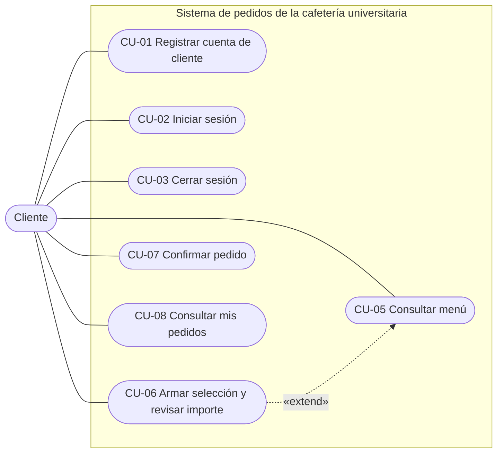
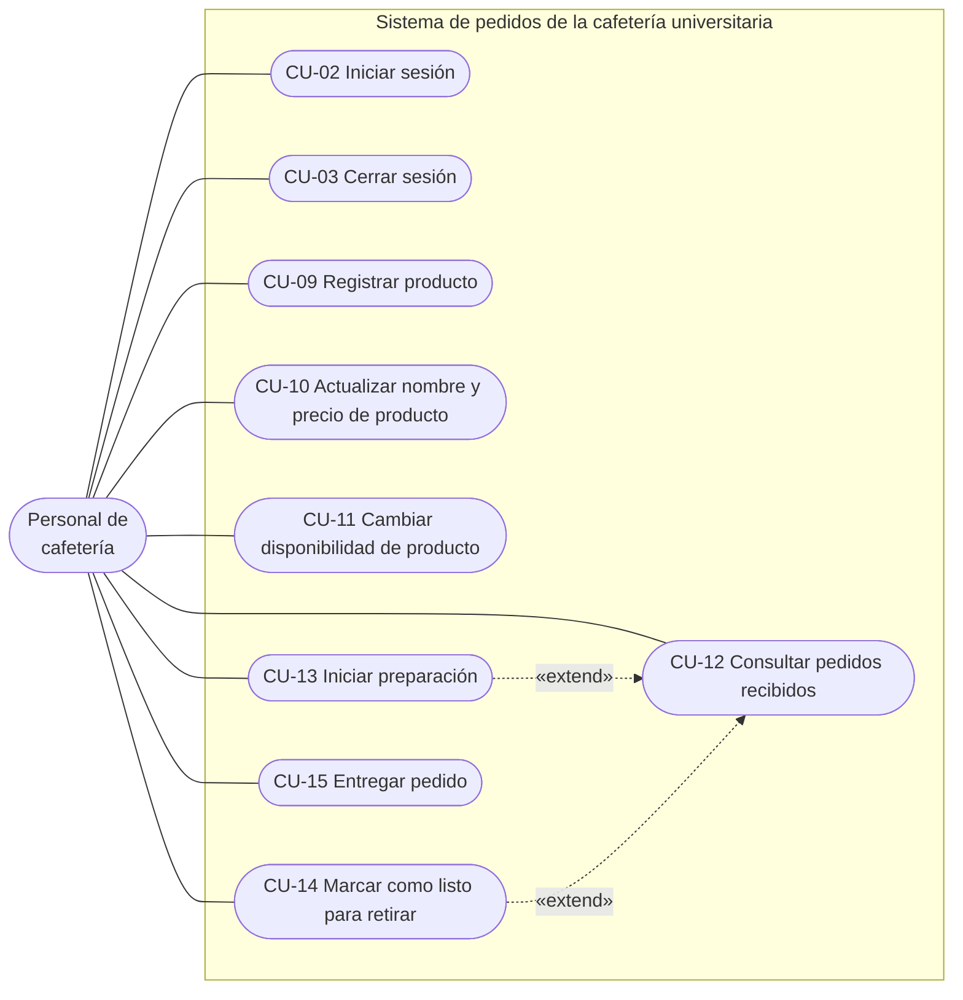
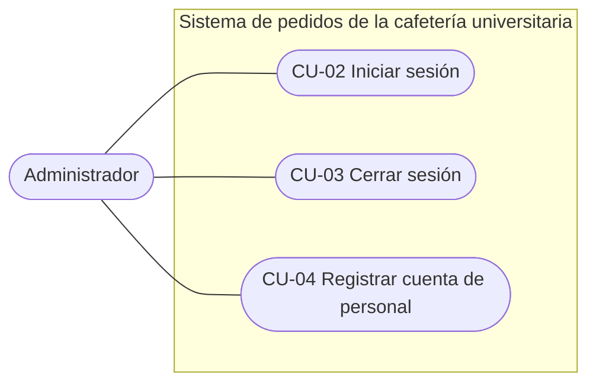

# Casos de uso

**Release:** 1.0  
**Versión del documento:** 1.0  

## 1. Actores

| Actor | Descripción |
|-------|------------|
| **Cliente** | Estudiante o docente que consulta el menú, registra pedidos y consulta su estado. Debe crear su propia cuenta para poder pedir. |
| **Personal de cafetería** | Trabajador que mantiene el menú y procesa los pedidos. Su cuenta la registra el administrador. |
| **Administrador** | Responsable que registra las cuentas del personal. Su cuenta ya existe en el sistema. |

## 2. Diagramas de casos de uso

### 2.1 Cliente
 

 
### 2.2 Personal de cafetería
 

 
### 2.3 Administrador
 

## 3. Catálogo de casos de uso

| CU | Nombre | Actores | Historias de usuario |
|----|--------|---------|----------------------|
| CU-01 | Registrar cuenta de cliente | Cliente | HU-01 |
| CU-02 | Iniciar sesión | Cliente, Personal, Administrador | HU-02 |
| CU-03 | Cerrar sesión | Cliente, Personal, Administrador | HU-02 |
| CU-04 | Registrar cuenta de personal | Administrador | HU-03 |
| CU-05 | Consultar menú | Cliente | HU-04 |
| CU-06 | Armar selección y revisar importe | Cliente | HU-05, HU-06 |
| CU-07 | Confirmar pedido | Cliente | HU-07 |
| CU-08 | Consultar mis pedidos | Cliente | HU-08 |
| CU-09 | Registrar producto | Personal | HU-09 |
| CU-10 | Actualizar nombre y precio de producto | Personal | HU-10 |
| CU-11 | Cambiar disponibilidad de producto | Personal | HU-11 |
| CU-12 | Consultar pedidos recibidos | Personal | HU-12 |
| CU-13 | Iniciar preparación | Personal | HU-13 |
| CU-14 | Marcar como listo para retirar | Personal | HU-14 |
| CU-15 | Entregar pedido | Personal (Cliente como actor secundario) | HU-15 |

Todos los casos de uso, excepto CU-01 y CU-02, requieren una sesión activa con el rol indicado. Los accesos sin sesión o con un rol no permitido se resuelven como se describe en los flujos A.1 y A.2 de CU-02.

## 4. Descripción de los casos de uso

### CU-01 — Registrar cuenta de cliente

**Historia de usuario:** HU-01

**Actores**

* **Cliente**: persona sin cuenta que necesita una para hacer pedidos.

**Descripción**  
El cliente completa el formulario de registro con sus datos y una contraseña. El sistema valida los datos, verifica que no exista otra cuenta con la misma cédula o RUC, o el mismo correo, crea la cuenta con un código de cliente único y lo lleva al inicio de sesión.

**Precondiciones**
1. No existe una sesión activa.
2. El cliente se encuentra en la página de registro.

**Postcondiciones**  

*Éxito*

* Se crea la cuenta del cliente con un código de cliente único.
* La contraseña queda almacenada cifrada, nunca en texto plano.
* El cliente es dirigido al inicio de sesión con un mensaje de confirmación.   

*Fallo*

* No se crea ninguna cuenta.
* El cliente permanece en el formulario con un mensaje que explica el motivo.

**Flujo principal**

1. El cliente elige **Crear cuenta**.
2. El sistema muestra el formulario: nombre, apellido, cédula o RUC, celular, correo institucional, contraseña y confirmación de contraseña.
3. El cliente completa el formulario y lo envía.
4. El sistema valida los datos.
5. El sistema genera el código de cliente y registra la cuenta con la contraseña cifrada.
6. El sistema muestra un mensaje de confirmación y redirige al inicio de sesión.

**Flujos alternativos y de excepción**

*4.1 — Datos incompletos (CA-01.3)*  
4.1.1. En el paso 4, falta algún campo.  
4.1.2. El sistema indica los campos faltantes.  
4.1.3. El flujo regresa al paso 3.  

*4.2 — Formato inválido (CA-01.4)*  
4.2.1. En el paso 4, la cédula o el RUC no supera el algoritmo de validación ecuatoriano, el celular no tiene 10 dígitos numéricos, el correo no tiene formato válido o no pertenece al dominio @epn.edu.ec, o la contraseña tiene menos de 8 caracteres.  
4.2.2. El sistema informa el requisito incumplido.  
4.2.3. El flujo regresa al paso 3.  

*4.3 — Contraseñas distintas (CA-01.5)*  
4.3.1. En el paso 4, la contraseña y su confirmación no coinciden.  
4.3.2. El sistema lo informa.  
4.3.3. El flujo regresa al paso 3.  

*4.4 — Datos ya registrados (CA-01.6)*  
4.4.1. En el paso 4, ya existe una cuenta con la misma cédula o RUC, o con el mismo correo.  
4.4.2. El sistema informa que ya existe una cuenta con ese dato.  
4.4.3. El flujo regresa al paso 3.  

---

### CU-02 — Iniciar sesión

**Historia de usuario:** HU-02

**Actores**

* **Cliente**, **Personal de cafetería** y **Administrador**: usuarios con cuenta registrada.

**Descripción**  
El usuario ingresa su correo y contraseña. El sistema valida las credenciales, identifica el rol de la cuenta, abre la sesión y lo redirige a la vista que corresponde a su rol.

**Precondiciones**

1. El usuario tiene una cuenta registrada.
2. No existe una sesión activa.

**Postcondiciones**  

*Éxito*

* Se abre una sesión asociada al usuario y a su rol.
* Un cliente ve el menú, el personal ve el panel de pedidos y el administrador ve la gestión de cuentas de personal.

*Fallo*

* No se abre ninguna sesión.
* El usuario permanece en el formulario con un mensaje de error.

**Flujo principal**

1. El usuario abre la página de inicio de sesión.
2. El sistema muestra el formulario con correo y contraseña.
3. El usuario ingresa sus credenciales y las envía.
4. El sistema valida las credenciales.
5. El sistema abre la sesión e identifica el rol del usuario.
6. El sistema redirige al usuario a la vista de su rol.

**Flujos alternativos y de excepción**  

*3.1 — Campos vacíos (CA-02.5)*  
3.1.1. En el paso 3, el correo o la contraseña están vacíos.  
3.1.2. El sistema solicita completar ambos campos.  
3.1.3. El flujo regresa al paso 3.  

*4.1 — Credenciales incorrectas (CA-02.4)*  
4.1.1. En el paso 4, el correo no existe o la contraseña no coincide.  
4.1.2. El sistema muestra el mensaje «Correo o contraseña incorrectos», sin indicar cuál falló.  
4.1.3. El flujo regresa al paso 3.  

*A.1 — Vista protegida sin sesión (CA-02.6)*  
A.1.1. En cualquier momento, un usuario sin sesión intenta abrir una vista protegida.  
A.1.2. El sistema lo redirige al inicio de sesión.  
A.1.3. El flujo continúa en el paso 2.  

*A.2 — Vista no permitida para el rol (CA-02.6)*  
A.2.1. En cualquier momento, un usuario con sesión intenta abrir una vista de otro rol (por ejemplo, un cliente abre el panel del personal, o el personal abre la gestión de cuentas).  
A.2.2. El sistema le niega el acceso.  
A.2.3. El usuario permanece en su vista actual.  

---

### CU-03 — Cerrar sesión

**Historia de usuario:** HU-02 (CA-02.7)

**Actores**

* **Cliente**, **Personal de cafetería** y **Administrador**: usuarios con sesión activa.

**Descripción**  
El usuario cierra su sesión. El sistema la termina y lo lleva al inicio de sesión.

**Precondiciones**

1. El usuario tiene una sesión activa.

**Postcondiciones**  

*Éxito*

* La sesión termina.
* Para abrir cualquier vista protegida, el usuario debe iniciar sesión de nuevo.

*Fallo*

* La sesión permanece activa y se informa el error.

**Flujo principal**

1. El usuario elige **Cerrar sesión**.
2. El sistema termina la sesión.
3. El sistema redirige al inicio de sesión.

---

### CU-04 — Registrar cuenta de personal

**Historia de usuario:** HU-03

**Actores**

* **Administrador**: usuario autenticado que registra a los trabajadores de la cafetería.

**Descripción**  
El administrador completa el formulario con los datos del trabajador. El sistema valida los datos y crea una cuenta con rol Personal, con la que el trabajador podrá iniciar sesión.

**Precondiciones**

1. El administrador tiene una sesión activa.
2. El administrador se encuentra en la gestión de cuentas de personal.

**Postcondiciones**  

*Éxito*

* Se crea una cuenta con rol Personal y contraseña cifrada.
* El trabajador puede iniciar sesión con ella.

*Fallo*

* No se crea ninguna cuenta.
* El administrador permanece en el formulario con un mensaje que explica el motivo.

**Flujo principal**

1. El administrador elige **Registrar personal**.
2. El sistema muestra el formulario: nombre, apellido, correo institucional, contraseña y confirmación de contraseña.
3. El administrador completa el formulario y lo envía.
4. El sistema valida los datos.
5. El sistema registra la cuenta con rol Personal y la contraseña cifrada.
6. El sistema muestra un mensaje de confirmación.

**Flujos alternativos y de excepción**

*4.1 — Datos incompletos (CA-03.3)*   
4.1.1. En el paso 4, falta algún campo.    
4.1.2. El sistema indica los campos faltantes.  
4.1.3. El flujo regresa al paso 3.  

*4.2 — Formato inválido (CA-03.4)*  
4.2.1. En el paso 4, el correo no tiene formato válido o no pertenece al dominio @epn.edu.ec, o la contraseña tiene menos de 8 caracteres.  
4.2.2. El sistema informa el requisito incumplido.  
4.2.3. El flujo regresa al paso 3.  

*4.3 — Contraseñas distintas (CA-03.5)*  
4.3.1. En el paso 4, la contraseña y su confirmación no coinciden.  
4.3.2. El sistema lo informa.  
4.3.3. El flujo regresa al paso 3.  

*4.4 — Correo ya registrado (CA-03.6)*  
4.4.1. En el paso 4, el correo ya pertenece a otra cuenta.  
4.4.2. El sistema informa el conflicto.  
4.4.3. El flujo regresa al paso 3.  

*A.1 — Usuario sin permiso (CA-03.7)*  
A.1.1. Un cliente o un trabajador del personal intenta abrir el registro de  cuentas de personal.  
A.1.2. El sistema le niega el acceso (ver CU-02, flujo A.2).  
A.1.3. El caso de uso termina sin crear ninguna cuenta.  

---

### CU-05 — Consultar menú

**Historia de usuario:** HU-04

**Actores**

* **Cliente**: usuario autenticado que quiere conocer los productos y precios antes de pedir.

**Descripción**  
El cliente visualiza el menú con el nombre, el precio en USD y la disponibilidad de cada producto. Desde esta vista puede comenzar a armar su selección (CU-06).

**Precondiciones**

1. El cliente tiene una sesión activa.

**Postcondiciones**  

*Éxito*

* El cliente visualiza el menú con los datos vigentes, incluidos los cambios recientes de precio o disponibilidad.
* No se modifica ningún dato.

*Fallo*

* El cliente recibe un mensaje de error y puede reintentar.

**Flujo principal**

1. El cliente elige **Ver menú**.
2. El sistema consulta los productos registrados.
3. El sistema muestra la lista con nombre, precio en USD y disponibilidad de cada producto.
4. El cliente revisa el menú.

**Flujos alternativos y de excepción**

*2.1 — Menú sin productos (CA-04.3)*  
2.1.1. En el paso 2, no hay productos registrados.  
2.1.2. El sistema informa que aún no hay productos.  
2.1.3. El caso de uso termina.  

*3.1 — Producto no disponible (CA-04.2)*  
3.1.1. En el paso 3, un producto está marcado como no disponible.  
3.1.2. El sistema lo muestra con la etiqueta **No disponible** y sin opción de agregarlo.  
3.1.3. El flujo continúa en el paso 4.  

---

### CU-06 — Armar selección y revisar importe

**Historias de usuario:** HU-05, HU-06

**Actores**

* **Cliente**: usuario autenticado que arma su pedido.

**Descripción**  
Partiendo del menú, el cliente agrega productos disponibles indicando la cantidad. El sistema valida la cantidad, mantiene la selección en la sesión y muestra un resumen con el subtotal de cada producto y el importe total. La selección es temporal: no se guarda hasta confirmar el pedido (CU-07).

**Precondiciones**

1. El cliente tiene una sesión activa.
2. El cliente se encuentra visualizando el menú (CU-05).
3. Existe al menos un producto disponible.

**Postcondiciones**  

*Éxito*

* La selección contiene los productos y las cantidades elegidos (enteros entre 1 y 10).
* El importe total es la suma de precio × cantidad de cada producto.
* No existe ningún pedido registrado (CA-05.7).

*Fallo*

* La selección no cambia y se informa el motivo.

**Flujo principal**

1. El cliente elige **Agregar** sobre un producto disponible.
2. El sistema solicita la cantidad.
3. El cliente indica la cantidad.
4. El sistema valida que sea un número entero entre 1 y 10.
5. El sistema agrega el producto a la selección. Si el producto ya estaba, suma la cantidad.
6. El sistema muestra el resumen con cantidad, precio unitario y subtotal de cada producto, y el importe total.

El cliente puede repetir los pasos 1 a 6 con otros productos.

**Flujos alternativos y de excepción**

*1.1 — Producto no disponible (CA-05.4)*  
1.1.1. En el paso 1, el producto está marcado como no disponible.  
1.1.2. El sistema no ofrece la opción de agregarlo.  
1.1.3. El caso de uso termina sin cambios en la selección.  

*4.1 — Cantidad inválida (CA-05.3)*  
4.1.1. En el paso 4, la cantidad está vacía, es cero, negativa, decimal, no numérica o mayor que 10.  
4.1.2. El sistema informa que debe ser un entero entre 1 y 10.  
4.1.3. El flujo regresa al paso 3 sin cambiar la selección.  

*5.1 — La suma supera el máximo (CA-05.5)*  
5.1.1. En el paso 5, el producto ya estaba en la selección y la suma de cantidades supera 10.  
5.1.2. El sistema informa el máximo permitido y deja la cantidad como estaba.  
5.1.3. El flujo continúa en el paso 6.  

*6.1 — Modificar la cantidad (CA-05.6, CA-06.2)*  
6.1.1. En el paso 6, el cliente cambia la cantidad de un producto de la selección.  
6.1.2. El sistema valida la nueva cantidad como en el paso 4 y recalcula el importe.  
6.1.3. El flujo regresa al paso 6.  

*6.2 — Quitar un producto (CA-05.6, CA-06.3)*  
6.2.1. En el paso 6, el cliente quita un producto de la selección.  
6.2.2. El sistema recalcula el importe. Si no quedan productos, muestra el importe 0.00 y no permite confirmar.  
6.2.3. El flujo regresa al paso 6.  

---

### CU-07 — Confirmar pedido

**Historia de usuario:** HU-07

**Actores**

* **Cliente**: usuario autenticado que confirma su pedido.

**Descripción**  
Desde el resumen de su selección, el cliente revisa y confirma el pedido. El sistema valida las reglas de negocio con los datos vigentes, genera un código de retiro único, registra el pedido en estado Pendiente y muestra el resumen con el código.

**Precondiciones**

1. El cliente tiene una sesión activa.
2. La selección contiene al menos un producto (CU-06).

**Postcondiciones**  

*Éxito*

* Se crea un pedido asociado al cliente, en estado **Pendiente**, con fecha de registro, importe total y código de retiro único.
* Cada detalle del pedido guarda el producto, la cantidad y el precio vigente al confirmar. Ese precio no cambia aunque el menú se modifique después.
* La selección queda vacía.
* El cliente ve el resumen y el código, y se le indica que el pago se realiza presencialmente.

*Fallo*

* No se crea ningún pedido.
* La selección se conserva y el cliente recibe un mensaje con el motivo.

**Flujo principal**

1. Desde el resumen de su selección, el cliente elige **Confirmar pedido**.
2. El sistema muestra la revisión final (productos, cantidades e importe total) y solicita confirmación.
3. El cliente confirma.
4. El sistema valida que haya al menos un producto, que cada cantidad sea un entero entre 1 y 10, que todos los productos sigan disponibles y que los precios no hayan cambiado.
5. El sistema genera un código de retiro único.
6. El sistema registra el pedido y sus detalles en estado Pendiente, en una sola operación.
7. El sistema muestra el resumen y el código de retiro, indica que el pago es presencial y vacía la selección.

**Flujos alternativos y de excepción**

*2.1 — El cliente no confirma*  
2.1.1. En el paso 2, el cliente elige **Volver**.  
2.1.2. El sistema regresa al resumen de la selección sin crear el pedido.  
2.1.3. El caso de uso termina.  

*4.1 — Producto que dejó de estar disponible (CA-07.4)*  
4.1.1. En el paso 4, uno o más productos ya no están disponibles.  
4.1.2. El sistema informa cuáles son y no crea el pedido.  
4.1.3. El cliente puede quitarlos de la selección (CU-06, flujo 6.2). La selección se conserva.  

*4.2 — Precio modificado (CA-07.5)*  
4.2.1. En el paso 4, el precio de algún producto cambió desde que se armó la selección.  
4.2.2. El sistema informa el nuevo importe y no crea el pedido.  
4.2.3. El flujo regresa al paso 2 con los precios actualizados. La selección se conserva.  

*4.3 — Selección vacía (CA-07.6)*  
4.3.1. En el paso 4, la selección no tiene productos.  
4.3.2. El sistema informa que el pedido debe tener al menos un producto. 
4.3.3. El caso de uso termina sin crear el pedido.  

*5.1 — Código repetido*  
5.1.1. En el paso 5, el código generado ya existe.  
5.1.2. El sistema genera un nuevo código.  
5.1.3. El flujo continúa en el paso 5.  

*6.1 — Error al registrar el pedido*  
6.1.1. En el paso 6, ocurre un error al guardar.  
6.1.2. El sistema no deja un pedido parcial e informa que debe intentarlo de nuevo.  
6.1.3. El caso de uso termina conservando la selección.  

---

### CU-08 — Consultar mis pedidos

**Historia de usuario:** HU-08

**Actores**

* **Cliente**: usuario autenticado que quiere saber en qué etapa están sus pedidos.

**Descripción**  
El cliente consulta la lista de sus pedidos con código, fecha, estado e importe, y puede abrir el detalle de cada uno. El sistema no envía notificaciones: el cliente consulta cuando lo necesita.

**Precondiciones**

1. El cliente tiene una sesión activa.

**Postcondiciones**  

*Éxito*

* El cliente visualiza solo sus propios pedidos, con el estado actual.
* No se modifica ningún dato.

*Fallo*

* El cliente recibe un mensaje de error y puede reintentar.

**Flujo principal**

1. El cliente elige **Mis pedidos**.
2. El sistema recupera los pedidos del cliente, del más reciente al más antiguo.
3. El sistema muestra la lista con código de retiro, fecha, estado e importe.
4. El cliente selecciona un pedido.
5. El sistema muestra el detalle: productos, cantidades, precios registrados, importe total y estado.

**Flujos alternativos y de excepción**

*2.1 — El cliente no tiene pedidos (CA-08.6)*  
2.1.1. En el paso 2, el cliente no tiene pedidos.  
2.1.2. El sistema informa que aún no ha realizado pedidos.  
2.1.3. El caso de uso termina.  

*3.1 — Pedido listo para retirar (CA-08.5)*  
3.1.1. En el paso 3, un pedido está en estado Listo para retirar.  
3.1.2. El sistema lo resalta e indica que puede retirarlo presentando su código.  
3.1.3. El flujo continúa en el paso 4.  

---

### CU-09 — Registrar producto

**Historia de usuario:** HU-09

**Actores**

* **Personal de cafetería**: usuario autenticado que agrega un producto al menú.

**Descripción**  
El personal completa el formulario de un nuevo producto. El sistema valida los datos, le asigna un código único y lo registra; el producto aparece en el menú.

**Precondiciones**

1. El usuario tiene una sesión activa con rol Personal.
2. El usuario se encuentra en la gestión de productos.

**Postcondiciones**  

*Éxito*

* Se crea el producto con código único, nombre, precio y disponibilidad (disponible por defecto).
* El producto aparece en el menú.

*Fallo*

* No se crea ningún producto.
* El personal permanece en el formulario con un mensaje que explica el motivo.

**Flujo principal**

1. El personal elige Agregar producto.
2. El sistema muestra el formulario: nombre, precio y disponibilidad (por defecto, disponible).
3. El personal completa el formulario y lo envía.
4. El sistema valida los datos.
5. El sistema genera el código del producto y lo registra.
6. El sistema muestra una confirmación y el producto en la lista.

**Flujos alternativos y de excepción**

*4.1 — Datos incompletos (CA-09.2)*  
4.1.1. En el paso 4, falta el nombre o el precio.  
4.1.2. El sistema indica los campos faltantes.  
4.1.3. El flujo regresa al paso 3.

*4.2 — Precio inválido (CA-09.3)*  
4.2.1. En el paso 4, el precio no es numérico, es menor o igual a 0 o tiene más de 2 decimales.  
4.2.2. El sistema informa el requisito del precio.  
4.2.3. El flujo regresa al paso 3.

*4.3 — Nombre duplicado (CA-09.4)*  
4.3.1. En el paso 4, ya existe un producto con ese nombre, sin distinguir mayúsculas.  
4.3.2. El sistema informa el conflicto.  
4.3.3. El flujo regresa al paso 3.

*4.4 — Nombre demasiado largo (CA-09.5)*  
4.4.1. En el paso 4, el nombre supera los 70 caracteres.  
4.4.2. El sistema informa el máximo permitido.  
4.4.3. El flujo regresa al paso 3.

---

### CU-10 — Actualizar nombre y precio de producto

**Historia de usuario:** HU-10

**Actores**

* **Personal de cafetería**: usuario autenticado que mantiene el menú.

**Descripción**  
El personal modifica el nombre o el precio de un producto existente. Los productos no se eliminan. El cambio de precio solo afecta a los pedidos nuevos.

**Precondiciones**

1. El usuario tiene una sesión activa con rol Personal.
2. Existe al menos un producto registrado.

**Postcondiciones**  

*Éxito*

* El producto queda actualizado.
* Los nuevos pedidos usan el precio nuevo; los pedidos ya confirmados conservan el precio con el que se registraron.

*Fallo*

* El producto no cambia y se informa el motivo.

**Flujo principal**

1. Desde la lista de productos, el personal elige **Editar** sobre uno.
2. El sistema muestra el formulario con los datos actuales.
3. El personal modifica el nombre y/o el precio y guarda.
4. El sistema valida los datos.
5. El sistema actualiza el producto.
6. El sistema muestra una confirmación y la lista actualizada.

**Flujos alternativos y de excepción**

*3.1 — Cancelar la edición*  
3.1.1. En el paso 3, el personal elige Cancelar.  
3.1.2. El sistema regresa a la lista sin cambios.  
3.1.3. El caso de uso termina.

*4.1 — Datos inválidos (CA-10.3)*  
4.1.1. En el paso 4, el nombre está vacío o supera los 70 caracteres, o el precio es inválido.  
4.1.2. El sistema informa el requisito incumplido.  
4.1.3. El flujo regresa al paso 3.

*4.2 — Nombre duplicado (CA-10.4)*  
4.2.1. En el paso 4, el nombre pertenece a otro producto.  
4.2.2. El sistema informa el conflicto.  
4.2.3. El flujo regresa al paso 3.

---

### CU-11 — Cambiar disponibilidad de producto

**Historia de usuario:** HU-11

**Actores**

* **Personal de cafetería**: usuario autenticado que mantiene el menú.

**Descripción**  
El personal marca un producto como disponible o no disponible directamente desde la lista de productos. El flujo es el mismo en ambos sentidos.

**Precondiciones**

1. El usuario tiene una sesión activa con rol Personal.
2. Existe al menos un producto registrado.

**Postcondiciones**  

*Éxito*

* La disponibilidad del producto queda actualizada.
* Un producto no disponible sigue visible en el menú con la etiqueta «No disponible» y no puede incluirse en nuevos pedidos.
* Un producto disponible puede incluirse en nuevos pedidos.
* Los pedidos ya confirmados no se ven afectados.

*Fallo*

* La disponibilidad no cambia y se informa el error.

**Flujo principal**

1. En la lista de productos, el personal cambia el control de disponibilidad de un producto.
2. El sistema actualiza la disponibilidad.
3. El sistema muestra la lista actualizada.

**Flujos alternativos y de excepción**

*2.1 — Error al guardar*  
2.1.1. En el paso 2, ocurre un error al guardar el cambio.  
2.1.2. El sistema informa el error y mantiene la disponibilidad anterior.  
2.1.3. El caso de uso termina.

---

### CU-12 — Consultar pedidos recibidos

**Historia de usuario:** HU-12

**Actores**

* **Personal de cafetería**: usuario autenticado que revisa los pedidos para atenderlos.

**Descripción**  
El personal visualiza los pedidos de todos los clientes, por defecto los Pendientes, con opción de filtrar por estado. Desde esta vista inicia los cambios de estado de preparación (CU-13 y CU-14). La entrega (CU-15) se realiza ingresando el código de retiro.

**Precondiciones**

1. El usuario tiene una sesión activa con rol Personal.

**Postcondiciones**  

*Éxito*

* El personal visualiza los pedidos con su estado actual.
* No se modifica ningún dato.

*Fallo*

* El personal recibe un mensaje de error y puede reintentar.

**Flujo principal**

1. El personal abre el panel de pedidos.
2. El sistema recupera los pedidos Pendientes, del más antiguo al más reciente.
3. El sistema muestra la lista con código de retiro, nombre y apellido del cliente, fecha, estado e importe total.
4. El personal selecciona un pedido.
5. El sistema muestra el detalle: productos, cantidades, precios registrados e importe total.

**Flujos alternativos y de excepción**

*3.1 — Filtrar por estado (CA-12.2)*  
3.1.1. En el paso 3, el personal elige un estado (Pendiente, En preparación, Listo para retirar o Entregado) o Todos.  
3.1.2. El sistema actualiza la lista según el filtro.  
3.1.3. El flujo continúa en el paso 4.

*3.2 — Sin resultados (CA-12.4)*  
3.2.1. En el paso 2 o 3.1, no hay pedidos que coincidan.  
3.2.2. El sistema informa que no hay pedidos para ese filtro.  
3.2.3. El caso de uso termina.

---

### CU-13 — Iniciar preparación

**Historia de usuario:** HU-13

**Actores**

* **Personal de cafetería**: usuario autenticado.

**Descripción**  
Partiendo del detalle de un pedido Pendiente, el personal registra que inició su preparación. El sistema cambia el estado a En preparación, respetando el orden definido.

**Precondiciones**

1. El usuario tiene una sesión activa con rol Personal.
2. El personal visualiza el detalle de un pedido (CU-12).
3. El pedido está en estado **Pendiente**.

**Postcondiciones**  

*Éxito*

* El pedido pasa a estado **En preparación**.
* El cliente ve el nuevo estado al consultar su pedido (CU-08).

*Fallo*

* El estado del pedido no cambia y se informa el motivo.

**Flujo principal**

1. El personal selecciona un pedido Pendiente.
2. El sistema muestra el detalle con la acción **Iniciar preparación**.
3. El personal elige la acción.
4. El sistema verifica que el pedido siga en estado Pendiente.
5. El sistema cambia el estado a En preparación.
6. El sistema confirma el cambio y actualiza la lista.

**Flujos alternativos y de excepción**

*2.1 — El pedido no está Pendiente (CA-13.2)*  
2.1.1. En el paso 2, el pedido está en otro estado.  
2.1.2. El sistema no ofrece la acción **Iniciar preparación**.  
2.1.3. El caso de uso termina.

*4.1 — Estado modificado por otro usuario (CA-13.3)*  
4.1.1. En el paso 4, el estado del pedido ya cambió desde que se mostró el detalle.    
4.1.2. El sistema informa que el pedido ya no está Pendiente y actualiza la vista.    
4.1.3. El caso de uso termina sin cambios.

---

### CU-14 — Marcar como listo para retirar

**Historia de usuario:** HU-14

**Actores**

* **Personal de cafetería**: usuario autenticado.

**Descripción**  
Cuando termina la preparación, el personal marca el pedido como Listo para retirar. El sistema cambia el estado respetando el orden definido, sin saltos ni retrocesos.

**Precondiciones**

1. El usuario tiene una sesión activa con rol Personal.
2. El personal visualiza el detalle de un pedido (CU-12).
3. El pedido está en estado **En preparación**.

**Postcondiciones**  

*Éxito*

* El pedido pasa a estado **Listo para retirar**.
* El cliente ve el nuevo estado al consultar su pedido (CU-08).

*Fallo*

* El estado del pedido no cambia y se informa el motivo.

**Flujo principal**

1. El personal selecciona un pedido En preparación.
2. El sistema muestra el detalle con la acción **Marcar como listo**.
3. El personal elige la acción.
4. El sistema verifica que el pedido siga en estado En preparación.
5. El sistema cambia el estado a Listo para retirar.
6. El sistema confirma el cambio y actualiza la lista.

**Flujos alternativos y de excepción**

*2.1 — El pedido no está En preparación (CA-14.2, CA-14.3)*  
2.1.1. En el paso 2, el pedido está en otro estado (por ejemplo, Pendiente).  
2.1.2. El sistema no ofrece la acción **Marcar como listo**: no se permiten saltos de estado y en ningún estado se ofrece volver a uno anterior.  
2.1.3. El caso de uso termina.

*4.1 — Estado modificado por otro usuario (CA-14.4)*  
4.1.1. En el paso 4, el estado del pedido ya cambió desde que se mostró el detalle.  
4.1.2. El sistema informa que el pedido ya no está En preparación y actualiza la vista.  
4.1.3. El caso de uso termina sin cambios.

---

### CU-15 — Entregar pedido

**Historia de usuario:** HU-15

**Actores**

* **Personal de cafetería**: usuario autenticado que entrega el pedido.
* **Cliente**: no interactúa con el sistema en este caso de uso; presenta su código de retiro al personal.

**Descripción**  
El cliente presenta su código de retiro en el mostrador. El personal ingresa el código y el sistema localiza el pedido correspondiente y muestra su resumen. Si el pedido está Listo para retirar, el personal confirma la entrega y el sistema lo marca como Entregado, estado final.

**Precondiciones**

1. El usuario tiene una sesión activa con rol Personal.
2. El personal se encuentra en el panel de pedidos.
3. El cliente presenta el código de retiro.

**Postcondiciones**  

*Éxito*

* El pedido pasa a estado **Entregado** y no admite más cambios de estado.

*Fallo*

* El pedido conserva su estado y no se entrega.
* El personal recibe un mensaje que explica el motivo.

**Flujo principal**

1. El personal elige **Entregar pedido**.
2. El sistema solicita el código de retiro.
3. El personal ingresa el código que presenta el cliente.
4. El sistema valida el formato del código (tolerante a minúsculas y sin guion, CA-15.4), localiza el pedido y verifica que su estado sea Listo para retirar.
5. El sistema muestra el resumen del pedido (código, nombre y apellido del cliente, productos, cantidades e importe total) y solicita confirmar la entrega.
6. El personal confirma la entrega.
7. El sistema verifica nuevamente que el pedido siga Listo para retirar y cambia su estado a Entregado.
8. El sistema confirma la entrega.

**Flujos alternativos y de excepción**

*3.1 — Código vacío (CA-15.5)*  
3.1.1. En el paso 3, el personal no ingresa el código.  
3.1.2. El sistema lo solicita.  
3.1.3. El flujo regresa al paso 3.

*4.1 — Código inexistente (CA-15.2)*  
4.1.1. En el paso 4, no existe ningún pedido con ese código.  
4.1.2. El sistema informa que no se encontró un pedido con ese código.  
4.1.3. El flujo regresa al paso 3.

*4.2 — El pedido no está Listo para retirar (CA-15.3)*  
4.2.1. En el paso 4, el pedido está Pendiente o En preparación.  
4.2.2. El sistema informa su estado actual y no permite entregarlo.  
4.2.3. El caso de uso termina sin cambios.

*4.3 — El pedido ya fue entregado (CA-15.6)* 
4.3.1. En el paso 4, el pedido ya está en estado Entregado.  
4.3.2. El sistema informa que ya fue entregado.  
4.3.3. El caso de uso termina sin cambios.

*6.1 — El personal cancela (CA-15.7)*  
6.1.1. En el paso 6, el personal elige Cancelar.  
6.1.2. El sistema regresa al panel sin cambiar el pedido.  
6.1.3. El caso de uso termina.

*7.1 — Estado modificado por otro usuario (CA-15.8)*  
7.1.1. En el paso 7, el estado del pedido ya cambió desde que se mostró el resumen.  
7.1.2. El sistema informa que el pedido ya no está Listo para retirar y no realiza cambios.  
7.1.3. El caso de uso termina.