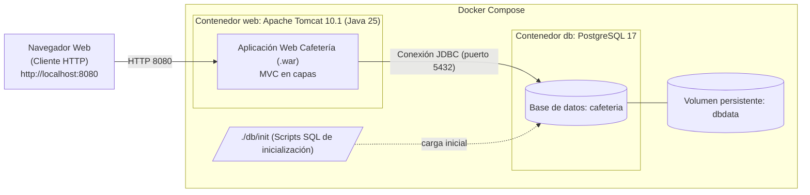
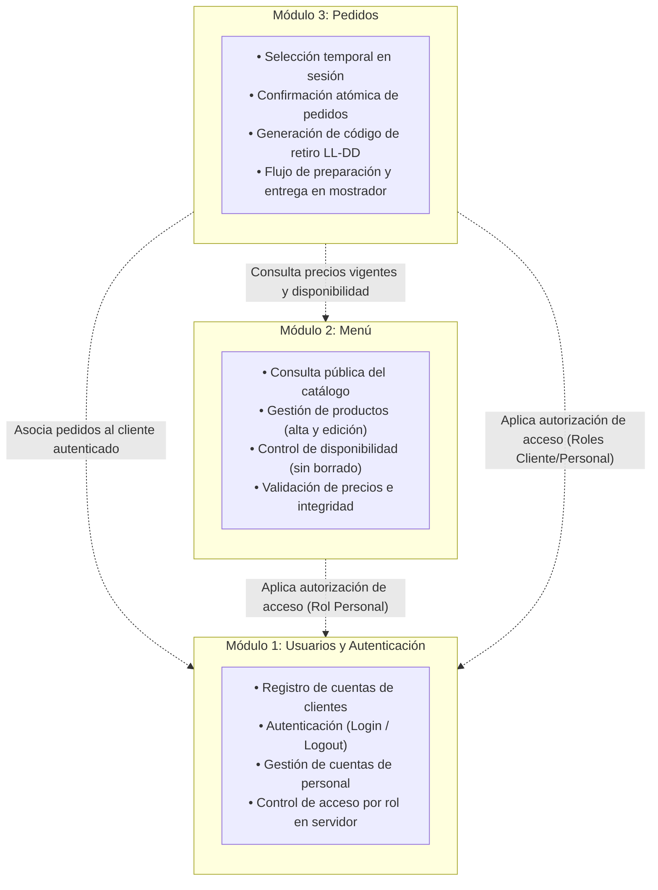

# Arquitectura de la aplicación

**Release:** 1.0  
**Versión del documento:** 1.0  

## 1. Visión general y despliegue

La aplicación adopta el patrón arquitectónico **Modelo-Vista-Controlador (MVC)** organizado en capas lógicas y se despliega mediante contenedores estandarizados con **Docker Compose**.

| Contenedor | Tecnología | Responsabilidad | Puerto |
|---|---|---|---|
| **web** | Apache Tomcat 10.1 con Eclipse Temurin JDK 25 | Ejecución de la aplicación web `.war` estructurada bajo el patrón MVC. | 8080 |
| **db** | PostgreSQL 17 | Almacenamiento persistente de datos (usuarios, productos, pedidos). | 5432 |

## 2. Modelo-Vista-Controlador (MVC)

| Capa | Responsabilidad | Tecnologías clave |
|---|---|---|
| **Vista** | Presentación visual al usuario e interacción en formularios web. No contiene lógica de negocio ni acceso directo a la base de datos. | JSP (Jakarta Server Pages), JSTL |
| **Controlador** | Interceptación de peticiones HTTP, verificación de autenticación y roles (`AuthFilter`), delegación a la capa de servicio y selección de la vista de respuesta. | Jakarta Servlet 6.0, Filtros HTTP |
| **Servicio** | Encapsula la lógica de negocio, reglas de validación, transaccionalidad atómica (ACID), hash de contraseñas y cálculo de importes. | Java 25, JDBC (transacciones) |
| **Modelo** | Representa las entidades y conceptos del dominio de la cafetería universitaria definidos en el modelo de dominio. | Clases Java POJO (Dominio) |
| **Datos** | Almacenamiento relacional con restricciones de integridad y unicidad. | PostgreSQL 17 |

## 3. Módulos del sistema

### 3.1 Responsabilidades de los módulos

1. **Módulo de Usuarios y Autenticación:**
   * Atiende las historias **HU-01**, **HU-02** y **HU-03**.
   * Gestiona el ciclo de vida de las cuentas de usuario (Cliente, Personal y Administrador), el cifrado seguro de credenciales con BCrypt (RNF-02) y la política de acceso seguro por rol en el servidor (RNF-03).
2. **Módulo de Menú:**
   * Atiende las historias **HU-04**, **HU-09**, **HU-10** y **HU-11**.
   * Gestiona el catálogo de alimentos y bebidas, permitiendo consultar precios y disponibilidad, registrar nuevos ítems y modificar su información sin permitir su eliminación (SUP-10).
3. **Módulo de Pedidos:**
   * Atiende las historias **HU-05**, **HU-06**, **HU-07**, **HU-08**, **HU-12**, **HU-13**, **HU-14** y **HU-15**.
   * Coordina el armado de la selección temporal en memoria de sesión (SUP-14), el registro atómico y congelamiento de precios del pedido confirmado (RN-NEG-04, RNF-06), la generación del código único `LL-DD` (SUP-09) y la progresión secuencial de estados de preparación y entrega (RN-NEG-06, RN-NEG-07).

### 3.2 Relaciones entre módulos
* **Pedidos $\rightarrow$ Menú:** El módulo de pedidos consulta al módulo de menú para verificar la disponibilidad y los precios vigentes de los productos al armar la selección y al confirmar el pedido.
* **Pedidos $\rightarrow$ Usuarios:** El módulo de pedidos obtiene la identidad del cliente autenticado desde la sesión para asociar los pedidos creados.
* **Autorización transversal:** Los módulos de Menú y Pedidos delegan la verificación de roles y permisos en los mecanismos de seguridad definidos en el módulo de Usuarios.

