# Diagramas de robustez

**Release:** 1.0  
**Versión del documento:** 1.0  

## 1. Notación

| Elemento | Forma en Mermaid | Estereotipo |
|---|---|---|
| Actor | Estadio `([ ])` | Actor |
| Boundary (vista) | Asimétrica `>[ ]` | `<<boundary>>` |
| Control (lógica del caso de uso) | Círculo `(( ))` | `<<control>>` |
| Entity (clase del dominio) | Cilindro `[( )]` | `<<entity>>` |

La numeración de los mensajes sigue los pasos y flujos alternativos de cada caso de uso.

## 2. Diagramas

### CU-01 — Registrar cuenta de cliente

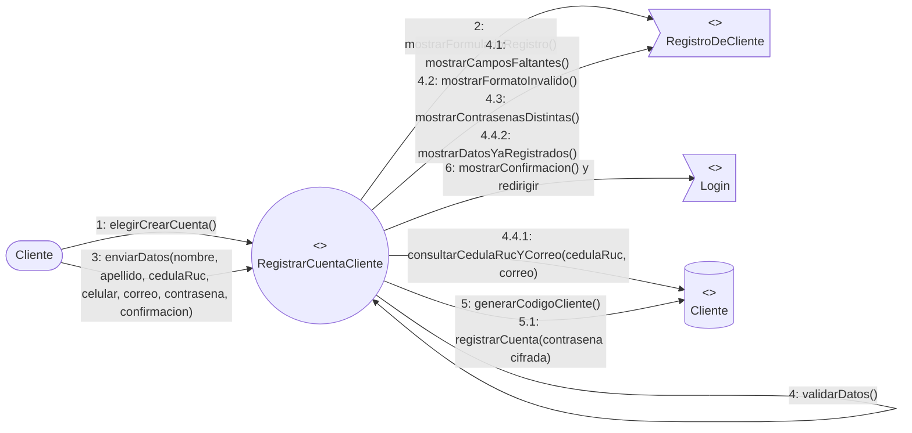

### CU-02 — Iniciar sesión

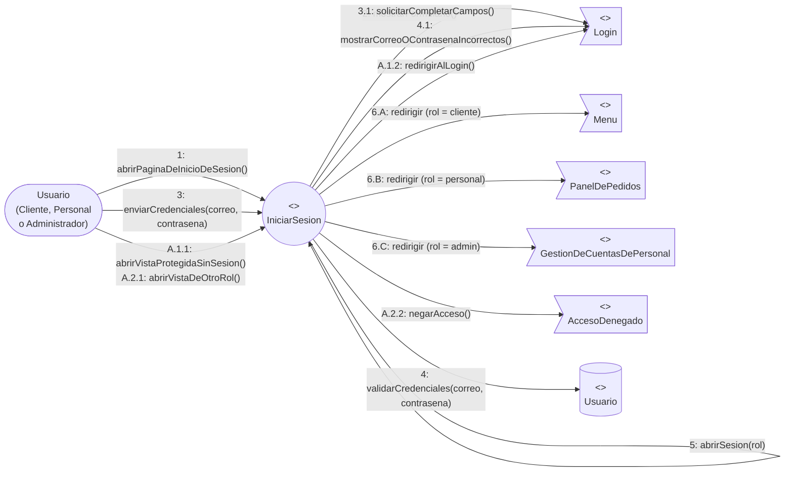

### CU-03 — Cerrar sesión

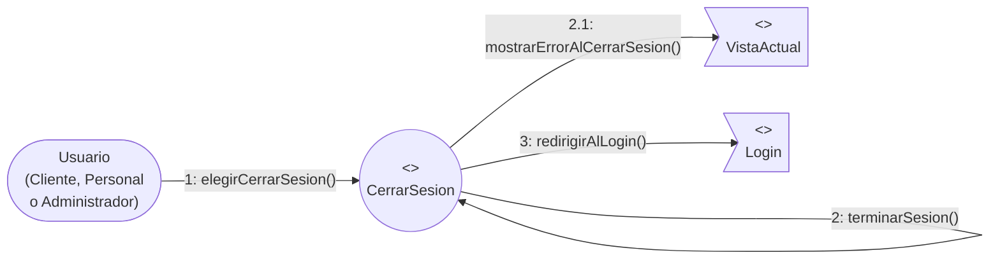

### CU-04 — Registrar cuenta de personal

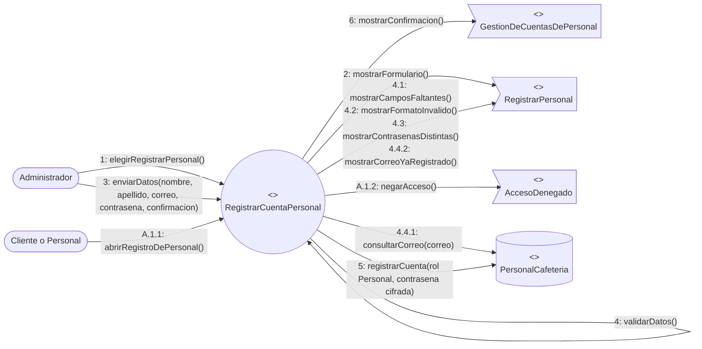

### CU-05 — Consultar menú

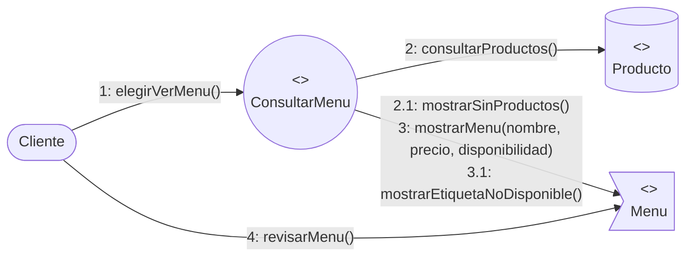

### CU-06 — Armar selección y revisar importe

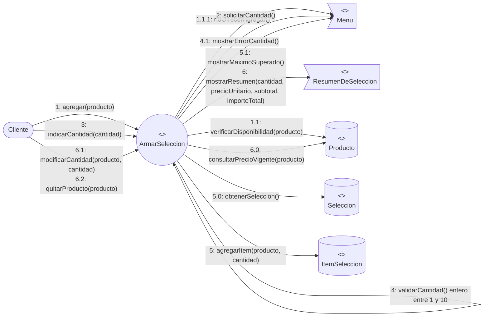

### CU-07 — Confirmar pedido

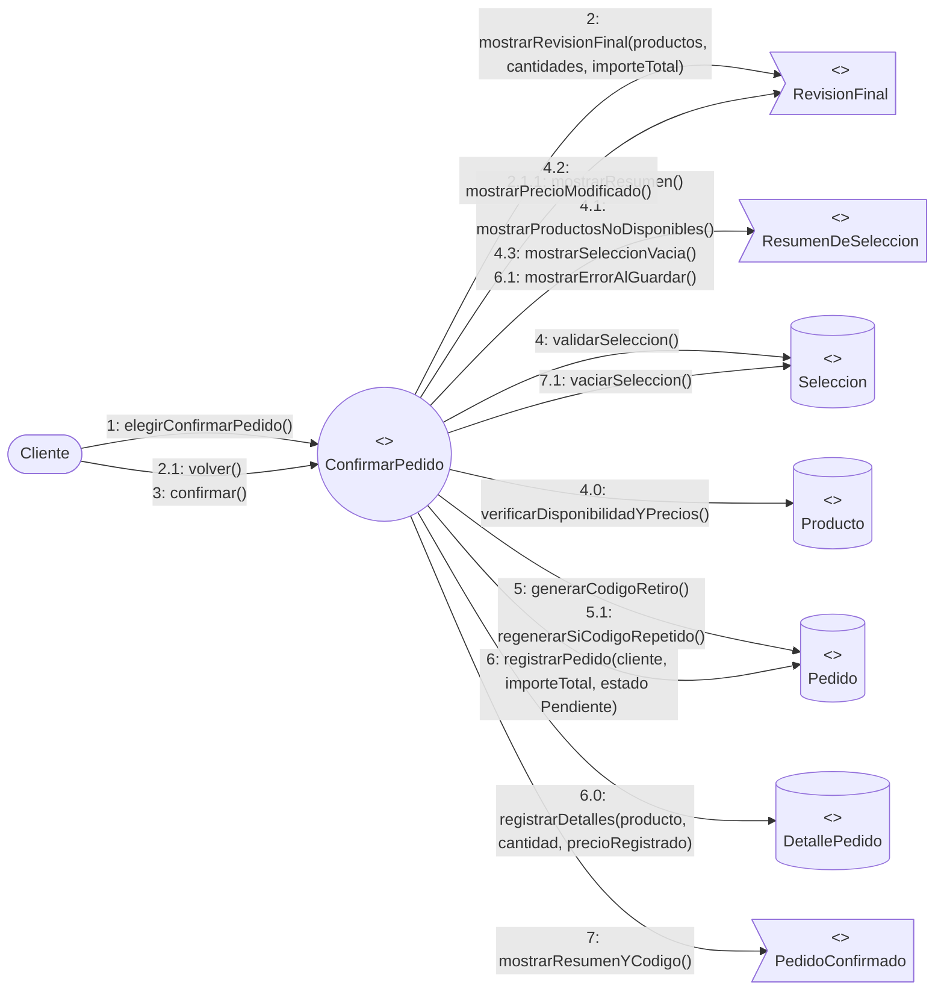

### CU-08 — Consultar mis pedidos

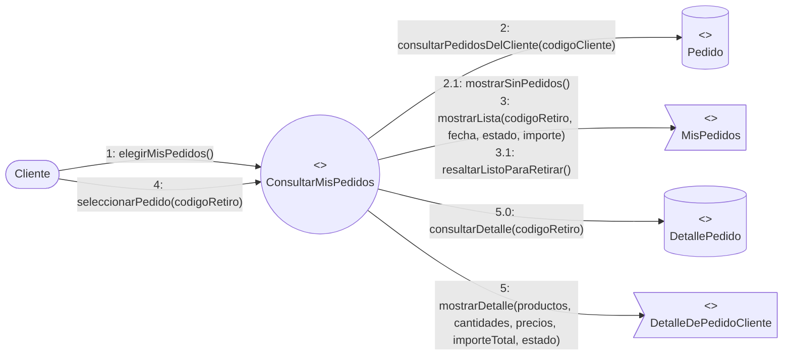

### CU-09 — Registrar producto

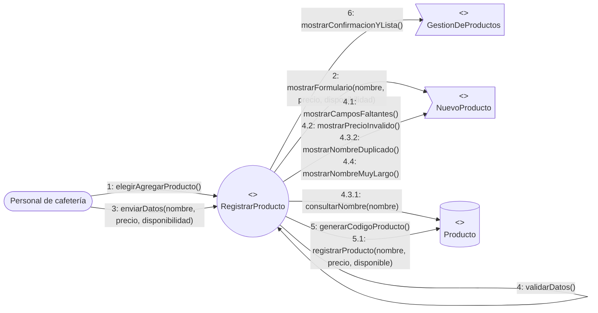

### CU-10 — Actualizar nombre y precio de producto

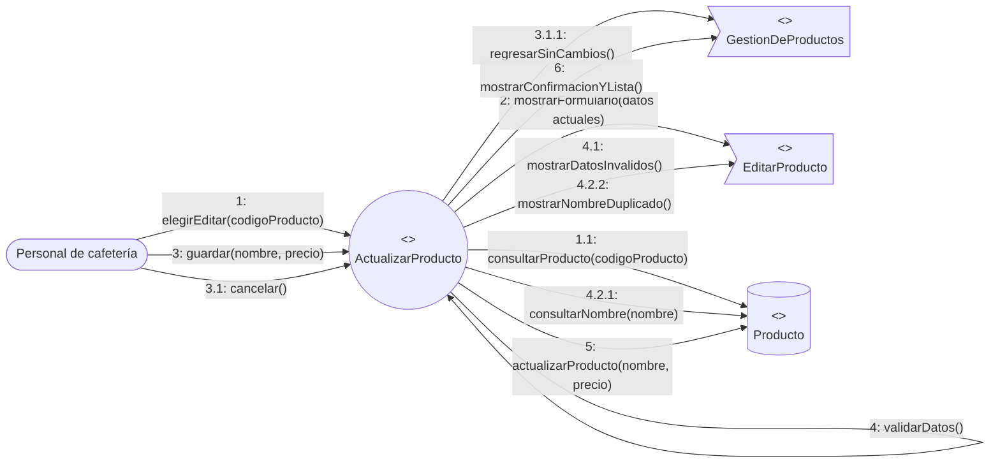

### CU-11 — Cambiar disponibilidad de producto

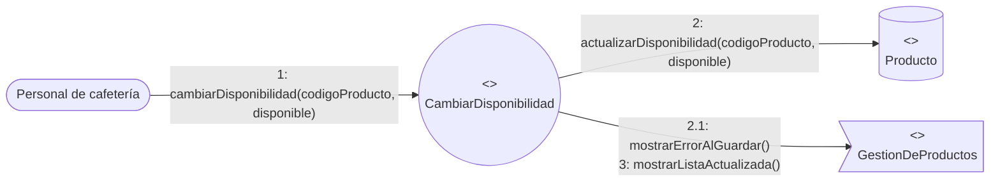

### CU-12 — Consultar pedidos recibidos

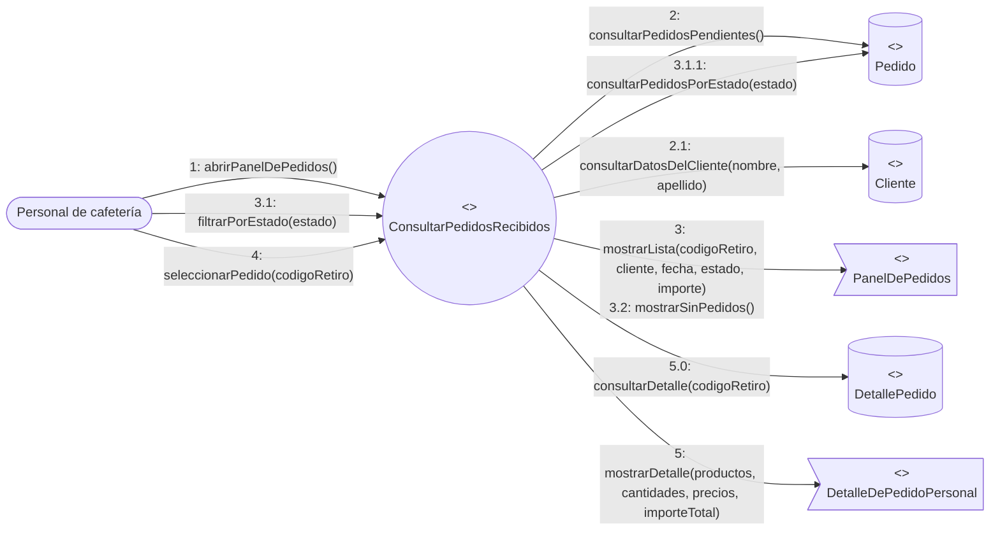

### CU-13 — Iniciar preparación

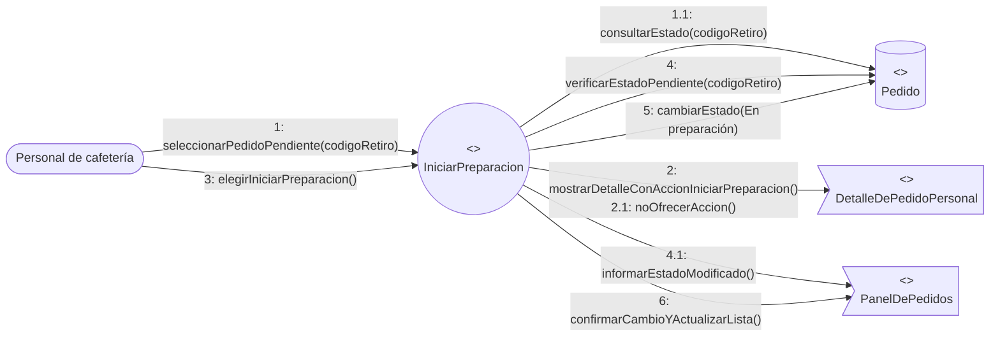

### CU-14 — Marcar como listo para retirar

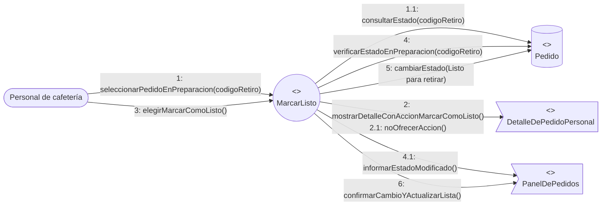

### CU-15 — Entregar pedido

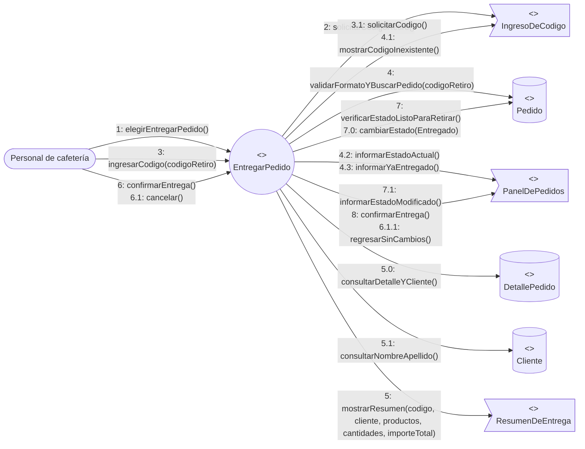