# Diagramas de secuencia de diseño (DSD)

**Release:** 1.0  
**Versión del documento:** 1.0  

## 1. Convenciones

| Elemento | Representación |
|---|---|
| Actor | Participante `actor` |
| Control | Participante con la etiqueta `«control»` |
| Vista (boundary) | Participante con la etiqueta `«boundary»` |
| Entidad (entity) | Participante con la etiqueta `«entity»` |
| `ruteador(): void` | Mensaje del control a sí mismo que decide a qué operación o vista se dirige la petición (como en el ejemplo base). |
| Flecha punteada | Valor de retorno de una consulta. |
| `alt` / `else` | Flujos alternativos y de excepción del caso de uso. La etiqueta indica el número del flujo (por ejemplo, `4.1`) y la condición va entre corchetes. |
| `opt` / `loop` | Flujo opcional o repetitivo. |

## 2. Diagramas

### CU-01 — Registrar cuenta de cliente

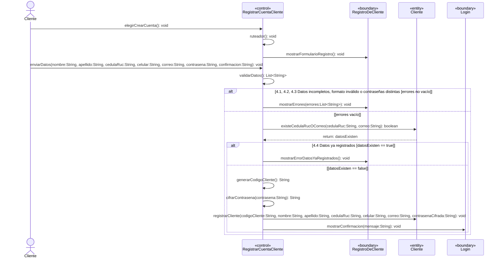

### CU-02 — Iniciar sesión

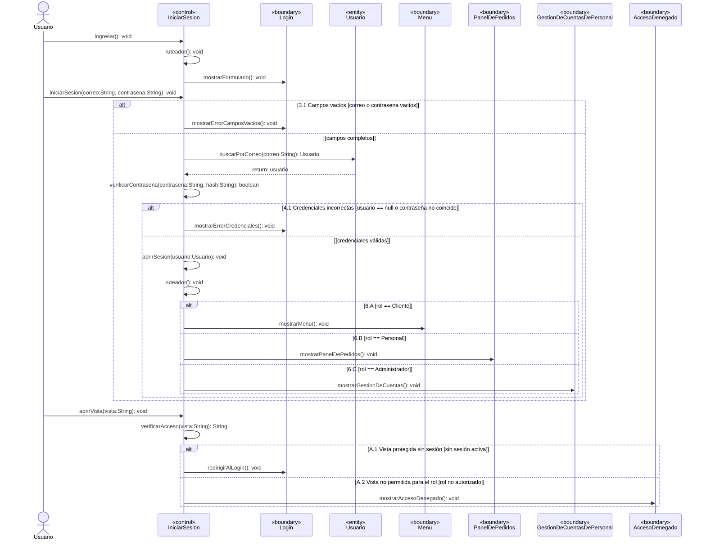

### CU-03 — Cerrar sesión

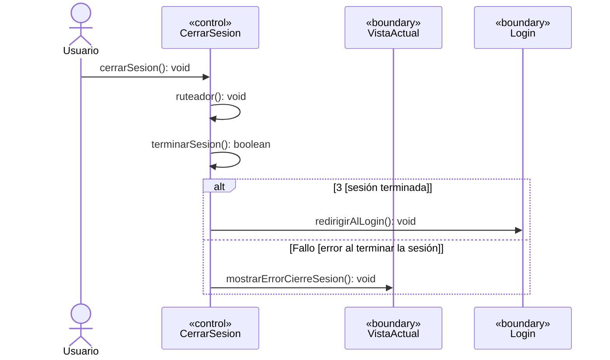

### CU-04 — Registrar cuenta de personal

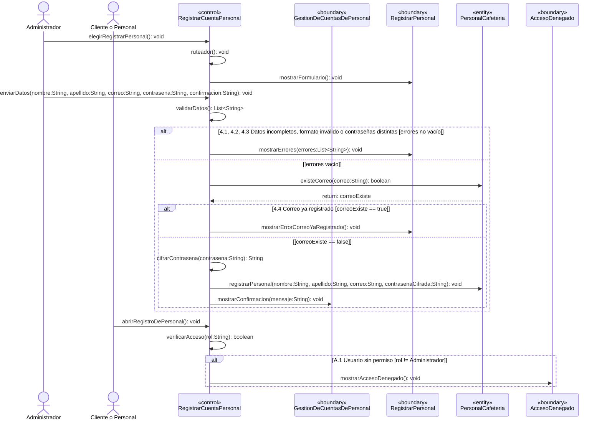

### CU-05 — Consultar menú

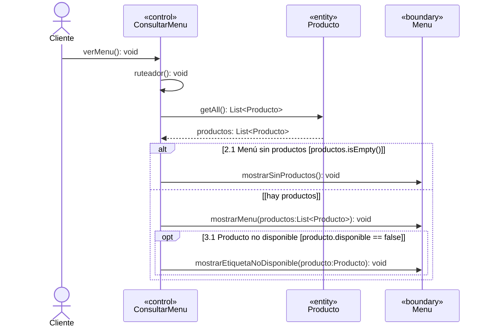

### CU-06 — Armar selección y revisar importe

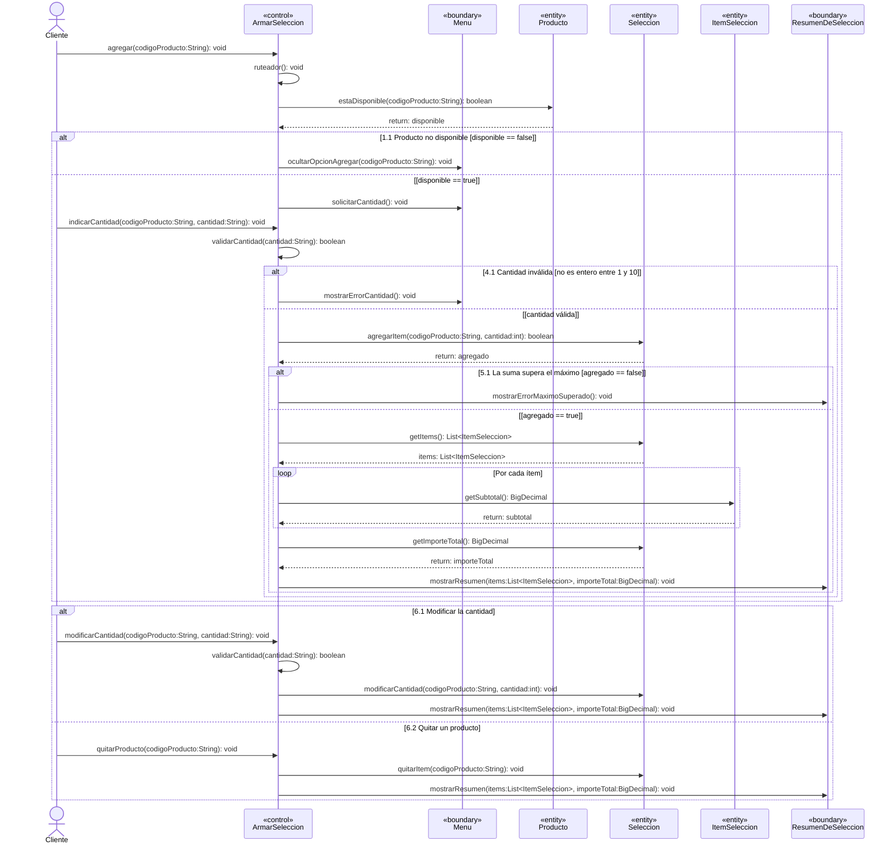

### CU-07 — Confirmar pedido

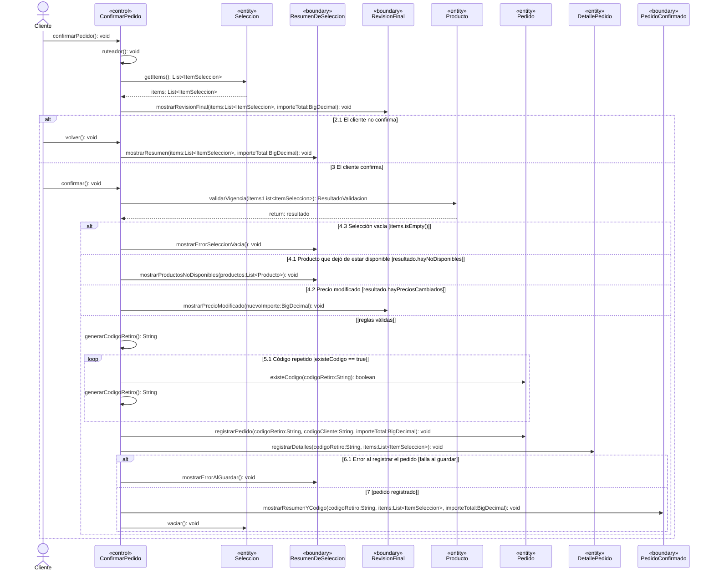

### CU-08 — Consultar mis pedidos

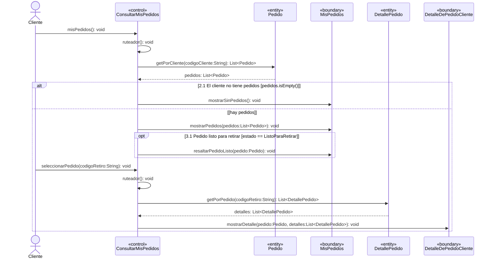

### CU-09 — Registrar producto

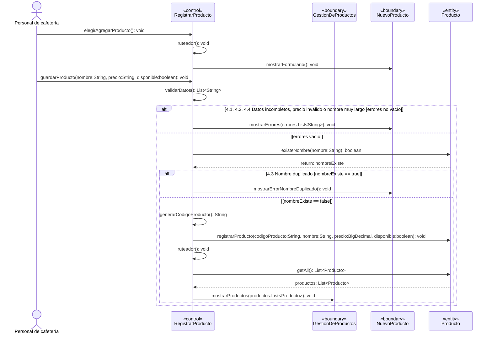

### CU-10 — Actualizar nombre y precio de producto

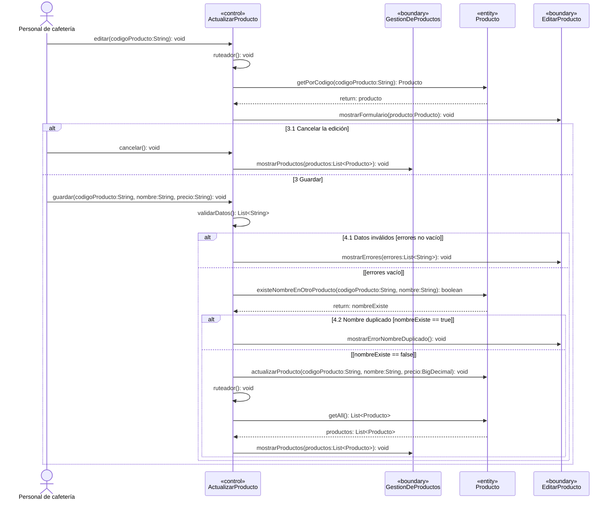

### CU-11 — Cambiar disponibilidad de producto

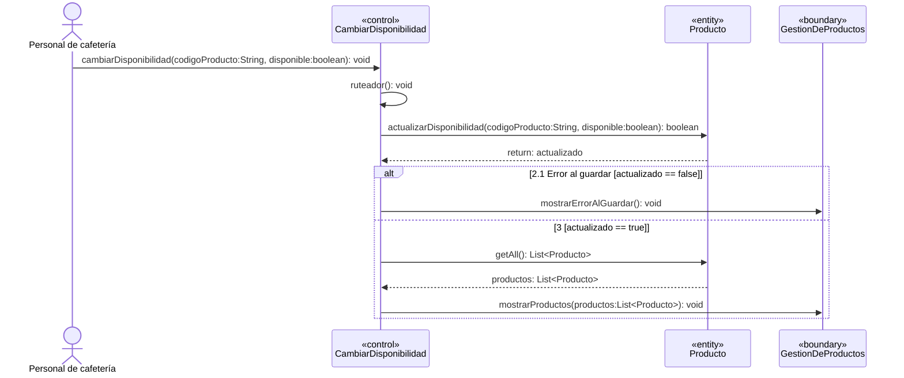

### CU-12 — Consultar pedidos recibidos

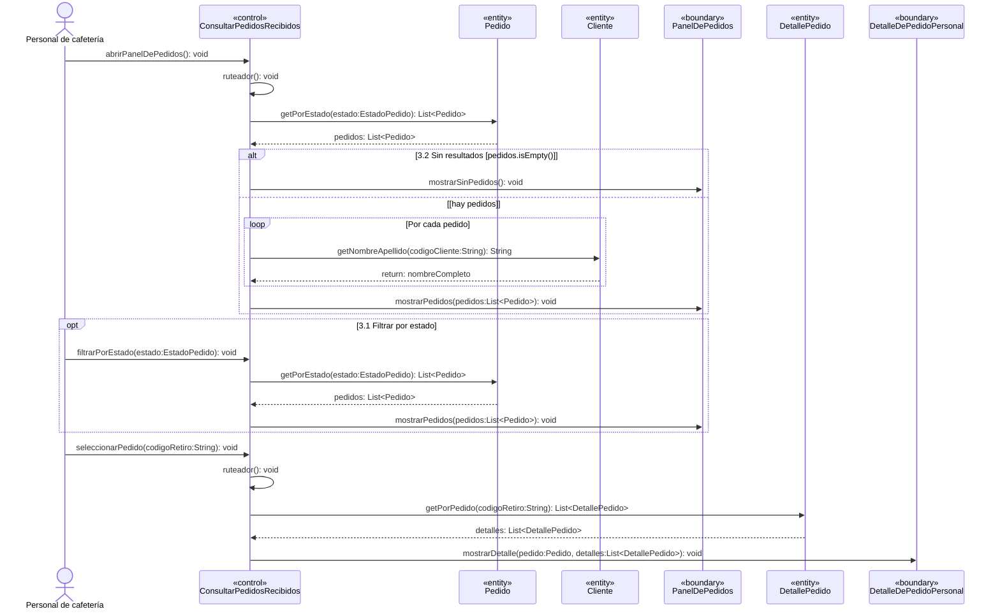

### CU-13 — Iniciar preparación

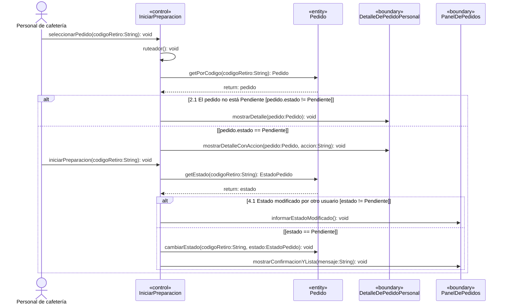

### CU-14 — Marcar como listo para retirar

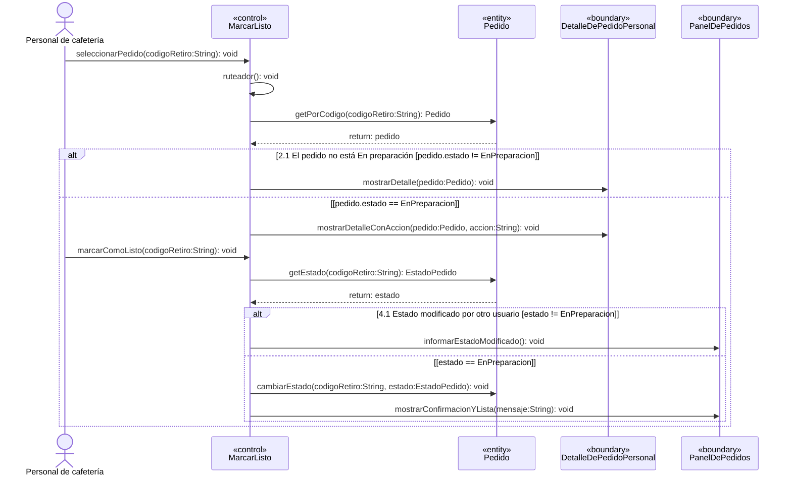

### CU-15 — Entregar pedido

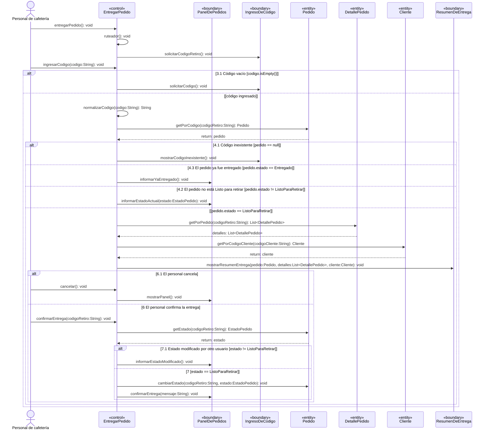