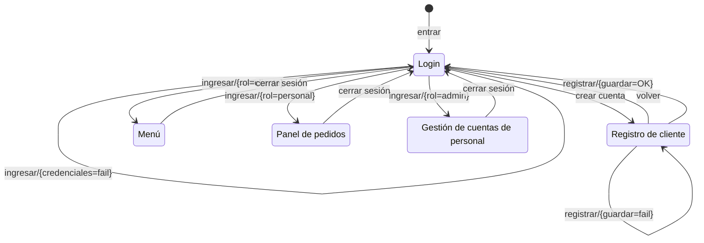
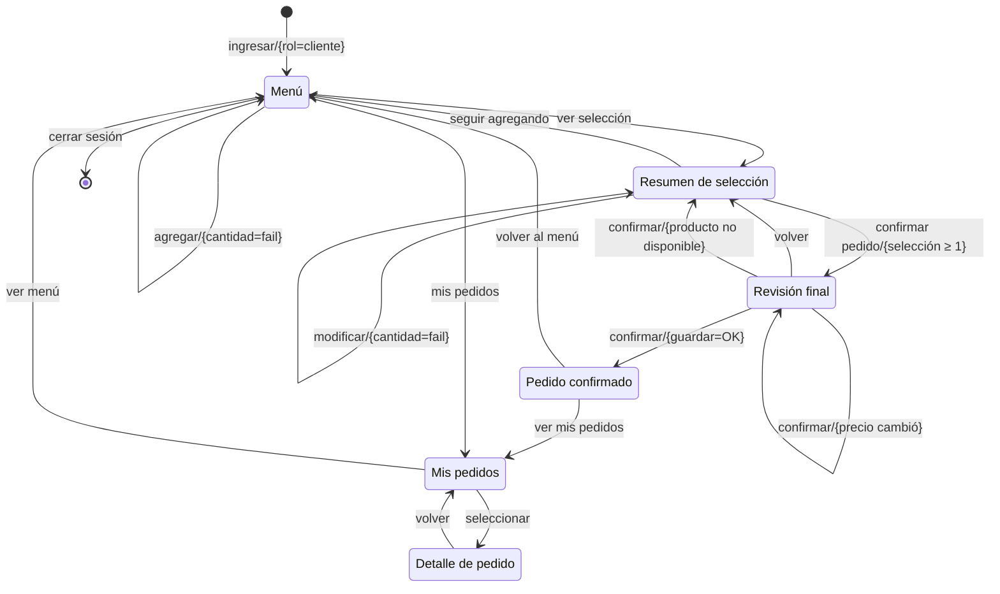
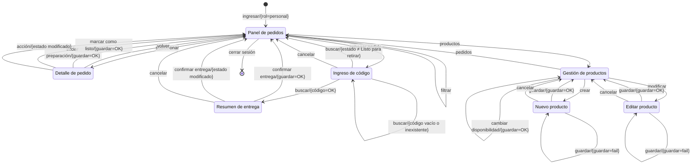
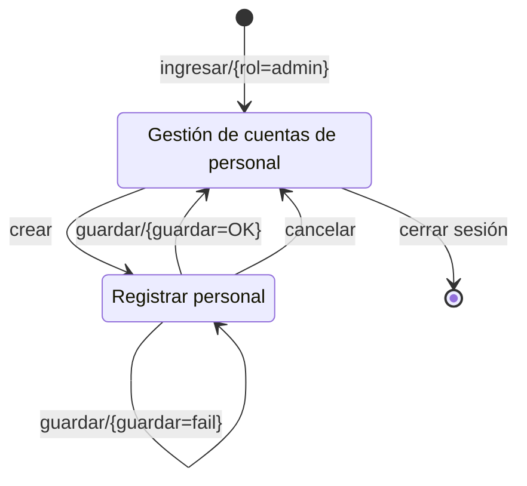

# Mapa navegacional

**Release:** 1.0  
**Versión del documento:** 1.0  

## 1. Notación conceptual

| Elemento | Significado |
|---|---|
| Círculo negro | Entrada al flujo del rol (punto de inicio de la interacción). |
| Círculo con anillo | Salida del flujo (cierre de sesión o finalización). |
| Rectángulo redondeado | Pantalla o vista de la interfaz de usuario. |
| `acción/{condición}` | La **acción del usuario**, seguida del **resultado o condición de negocio** que determina la navegación. Ejemplo: `ingresar/{rol=cliente}`. |
| `{guardar=OK}` / `{guardar=fail}` | La operación se completó exitosamente o falló la validación y se permanece en la misma vista con un mensaje informativo. |
| `{cantidad=OK}` / `{cantidad=fail}` | La cantidad ingresada cumple o no con la regla de negocio (número entero entre 1 y 10). |
| `{estado modificado}` | Condición de concurrencia: otro usuario modificó el estado del pedido mientras se visualizaba la pantalla. |
| `crear`, `modificar` | Acciones para abrir formularios de registro o edición de información. |

> [!NOTE]
> No existe la transición `eliminar`: los productos del menú no se eliminan del sistema (CA-10.5).

---

## 2. Diagramas de navegación

### 2.1 General

### 2.2 Cliente

### 2.3 Personal de cafetería

### 2.4 Administrador

## 3. Catálogo de vistas del sistema

| Vista / Pantalla | Propósito funcional para el usuario | Rol autorizado | Caso de uso |
|---|---|---|---|
| **Login** | Punto de acceso al sistema con correo y contraseña. Deriva automáticamente a la pantalla inicial del rol correspondiente. | Público / Todos | CU-02 |
| **Registro de cliente** | Formulario para que nuevos clientes ingresen sus datos y creen su cuenta personal. | Público (sin sesión) | CU-01 |
| **Menú** | Catálogo de productos con precios y estado de disponibilidad. Permite seleccionar cantidades para armar un pedido. | Cliente | CU-05, CU-06 |
| **Resumen de selección** | Vista de la selección temporal del cliente; permite revisar subtotales, modificar cantidades o quitar productos. | Cliente | CU-06 |
| **Revisión final** | Pantalla de confirmación previa a la creación definitiva del pedido, con desglose de ítems e importe total. | Cliente | CU-07 |
| **Pedido confirmado** | Pantalla de confirmación con el código de retiro generado (formato `LL-DD`) e indicación de pago presencial. | Cliente | CU-07 |
| **Mis pedidos** | Lista histórica de pedidos propios del cliente ordenados cronológicamente, indicando estado e importe. | Cliente | CU-08 |
| **Detalle de pedido (cliente)** | Vista individual del pedido con lista de productos, cantidades, precios registrados y estado actual. | Cliente | CU-08 |
| **Panel de pedidos** | Bandeja de pedidos recibidos por la cafetería, con filtros por estado para organizar la atención. | Personal de cafetería | CU-12 |
| **Detalle de pedido (personal)** | Vista de gestión de un pedido con acciones para iniciar su preparación o marcarlo como listo para retiro. | Personal de cafetería | CU-12, CU-13, CU-14 |
| **Ingreso de código** | Pantalla para ingresar el código de retiro presentado por el cliente en el mostrador. | Personal de cafetería | CU-15 |
| **Resumen de entrega** | Confirmación final de la entrega al localizar un pedido listo para retirar, mostrando datos del cliente y productos. | Personal de cafetería | CU-15 |
| **Gestión de productos** | Catálogo administrativo del menú; permite alternar la disponibilidad en un clic y acceder a la creación/edición. | Personal de cafetería | CU-09, CU-10, CU-11 |
| **Nuevo producto** | Formulario para registrar un nuevo producto con su nombre y precio en el menú. | Personal de cafetería | CU-09 |
| **Editar producto** | Formulario para modificar el nombre o precio de un producto existente. | Personal de cafetería | CU-10 |
| **Gestión de cuentas de personal** | Pantalla inicial del administrador para gestionar a los empleados de la cafetería y dar de alta nuevas cuentas. | Administrador | CU-04 |
| **Registrar personal** | Formulario exclusivo para que el administrador registre una nueva cuenta con rol Personal. | Administrador | CU-04 |

## 4. Políticas de navegación y reglas de acceso

| Situación de navegación | Comportamiento del sistema | Referencia de requisitos |
|---|---|---|
| Intento de acceso a una vista protegida sin sesión activa | Redirección inmediata a la pantalla de **Login**. | CA-02.6, CU-02 (A.1) |
| Intento de acceso a una vista de un rol no permitido | Se deniega el acceso y se muestra una pantalla de acceso denegado, permitiendo al usuario regresar a su vista principal. | CA-02.6, CU-02 (A.2), CU-04 (A.1) |
| Usuario con sesión activa intenta volver a la pantalla de Login | Se redirige automáticamente a su vista inicial según el rol que posee. | CU-02 |
| Cierre de sesión voluntario | Se termina la sesión y se redirige a la pantalla de **Login**. Las vistas protegidas quedan bloqueadas. | CA-02.7, CU-03 |
| Direccionamiento inicial tras autenticación exitosa | • **Cliente:** pantalla de **Menú**. • **Personal:** pantalla de **Panel de pedidos**. • **Administrador:** pantalla de **Gestión de cuentas de personal**. | CA-02.1 a CA-02.3 |

## 5. Supuestos de navegación y diseño de interacción

| ID | Supuesto | Justificación de diseño UX |
|---|---|---|
| **NAV-01** | La cantidad se indica en un campo junto a cada producto del menú; no hay una pantalla intermedia para pedirla. | Agiliza la interacción del cliente sin añadir pasos innecesarios antes de agregar a la selección. |
| **NAV-02** | La selección se revisa en una pantalla propia (`Resumen de selección`), a la que se accede desde el menú. | Permite al cliente revisar y ajustar su selección antes de pasar a la revisión final. |
| **NAV-03** | «Gestión de cuentas de personal» es la pantalla inicial del administrador, con acceso directo a **Registrar personal**. | Responde directamente a lo exigido en HU-03 y CU-04 para el rol Administrador. |
| **NAV-04** | Si el estado del pedido fue cambiado concurrentemente por otro usuario, el sistema notifica la situación y retorna al panel actualizado. | Garantiza la consistencia visual y evita acciones sobre pedidos en estados obsoletos (CU-13, CU-14, CU-15). |
| **NAV-05** | La alternancia entre «Panel de pedidos» y «Gestión de productos» se realiza mediante una barra de navegación superior para el personal. | Permite al personal de cafetería cambiar ágilmente entre atender pedidos y mantener el catálogo del menú. |

