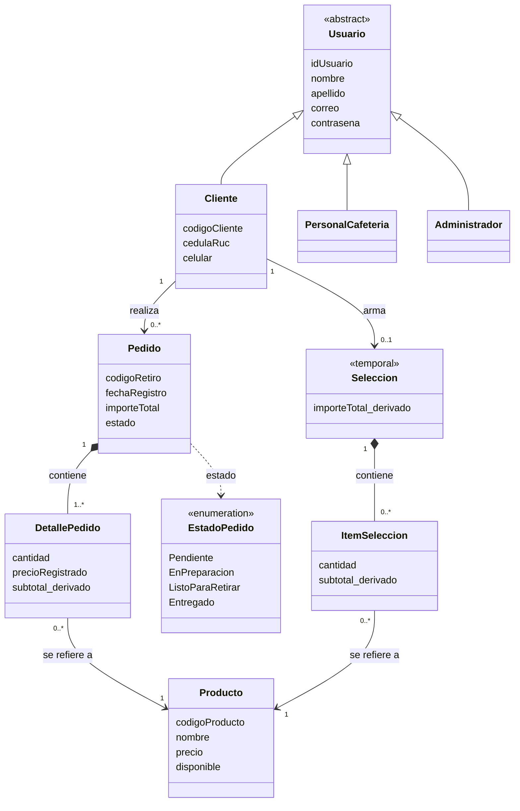

# Modelo de dominio

**Release:** 1.0  
**Versión del documento:** 1.0

## 1. Diagrama

## 2. Descripción de las clases

| Clase | Descripción | Atributos y restricciones |
|-------|-------------|---------------------------|
| **Usuario** | Persona con cuenta en el sistema. Agrupa los datos comunes de los tres roles. | `idUsuario`: identificador. `nombre`, `apellido`. `correo`: institucional (`@epn.edu.ec`), único; se usa para iniciar sesión. `contrasena`: mínimo 8 caracteres; se almacena cifrada (hash). |
| **Cliente** | Estudiante o docente que consulta el menú y hace pedidos. Se registra por sí mismo. | `codigoCliente`: único. `cedulaRuc`: cédula o RUC ecuatoriano válido según su algoritmo; único. `celular`: 10 dígitos numéricos. |
| **PersonalCafeteria** | Trabajador que mantiene el menú y atiende los pedidos. Su cuenta la registra el administrador. | Sin atributos propios. |
| **Administrador** | Responsable que registra las cuentas del personal. Su cuenta ya existe en el sistema. | Sin atributos propios. |
| **Producto** | Artículo ofrecido en el menú (alimento o bebida). | `codigoProducto`: único. `nombre`: hasta 70 caracteres; único sin distinguir mayúsculas. `precio`: en USD, mayor que 0, con 2 decimales como máximo. `disponible`: sí o no; un producto nuevo queda disponible por defecto. Los productos no se eliminan. |
| **Pedido** | Solicitud confirmada de un cliente. | `codigoRetiro`: formato **LL-DD** (dos letras mayúsculas A-Z, guion y dos dígitos 00-99, por ejemplo `AB-01`); único. `fechaRegistro`: fecha y hora de la confirmación. `importeTotal`: suma de precio registrado × cantidad de sus detalles. `estado`: un valor de `EstadoPedido`; inicia en Pendiente. |
| **DetallePedido** | Producto incluido en un pedido, con su cantidad y el precio considerado en la operación. | `cantidad`: entero entre 1 y 10. `precioRegistrado`: precio vigente del producto al confirmar; no cambia aunque el menú se modifique después. `/subtotal`: atributo derivado (cantidad × precioRegistrado). |
| **Seleccion** *(temporal)* | Lista de productos y cantidades que el cliente arma antes de confirmar. No es un pedido y no se guarda en la base de datos: vive en la sesión del cliente. | `/importeTotal`: atributo derivado (suma de los subtotales de sus ítems); vale 0.00 si está vacía. Se vacía al confirmar el pedido. |
| **ItemSeleccion** | Producto con su cantidad dentro de la selección. | `cantidad`: entero entre 1 y 10. `/subtotal`: atributo derivado (cantidad × precio vigente del producto). |
| **EstadoPedido** (enumeración) | Etapas de atención de un pedido. | Pendiente → En preparación → Listo para retirar → Entregado, en ese orden, sin saltos ni retrocesos. |
