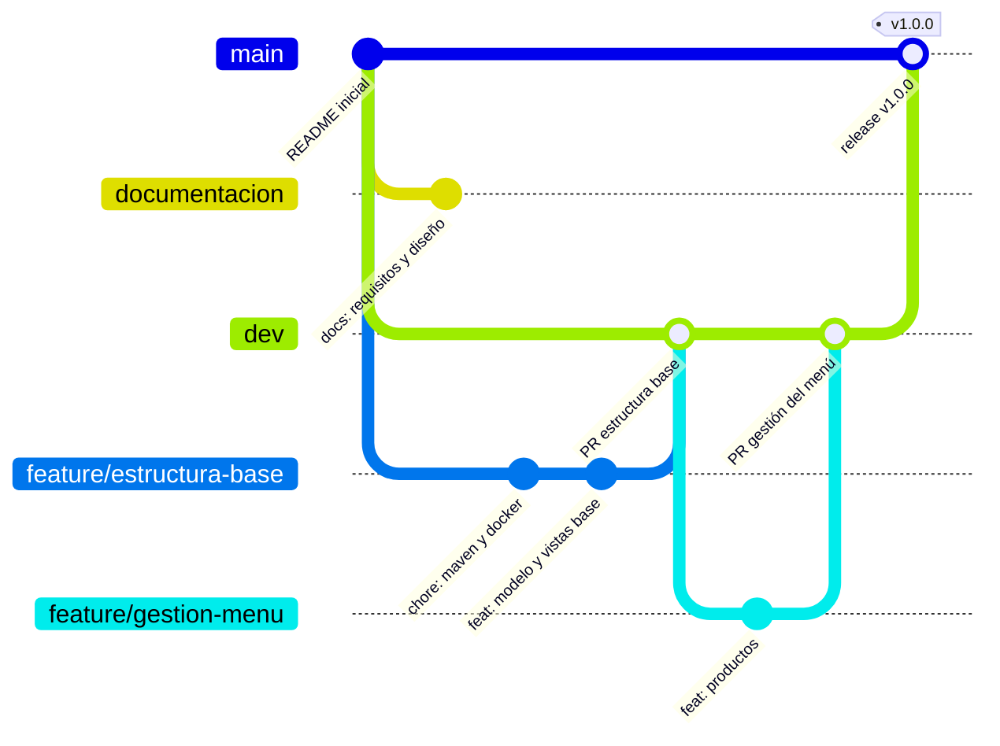

# Estrategia de ramificación y flujo de trabajo en Git

**Release:** 1.0  
**Versión del documento:** 1.1  

## 1. Ramas del repositorio

Trabajamos con GitHub Flow: cada cambio se hace en una rama propia, se sube, se abre un Pull Request y otro integrante lo revisa antes de integrarlo. Las ramas permanentes son tres y separan el código de los documentos.



| Rama | Tipo | Contenido | Quién escribe |
|---|---|---|---|
| `main` | Permanente | Código estable del release. | Nadie directamente. Solo recibe el Pull Request de `dev` cuando todo está probado. |
| `dev` | Permanente | Código en integración (`src/`, `db/`, `pom.xml`, Docker). | Nadie directamente. Recibe los Pull Request de las ramas `feature/*` y `fix/*`. |
| `documentacion` | Permanente | Carpetas `01` a `08` con los entregables documentales. | Nadie directamente. Recibe los Pull Request de las ramas `docs/*`. |
| `feature/<tema>` | Temporal | Una funcionalidad o historia de usuario. Sale de `dev`. | El responsable de la tarea. |
| `fix/<tema>` | Temporal | Corrección de un defecto. Sale de `dev`. | Quien encontró o tomó el defecto. |
| `docs/<tema>` | Temporal | Un documento o grupo de documentos. Sale de `documentacion`. | El responsable del documento. |

`documentacion` nunca se fusiona con `dev` ni con `main`: así el código entregado en `main` no lleva las carpetas de documentos, como pide la entrega.

## 2. Ramas temporales del Release 1.0

| Rama | Responsable | Historias / entregable | Destino |
|---|---|---|---|
| `feature/estructura-base` | Sebastián Guerrero | Maven, Docker, base de datos, modelo, sistema de diseño | `dev` |
| `feature/autenticacion` | Sebastián Guerrero | HU-01, HU-02, HU-03 | `dev` |
| `feature/gestion-menu` | Jhostin Cadena | HU-04, HU-09, HU-10, HU-11 | `dev` |
| `feature/pedido-cliente` | Melany | HU-05, HU-06, HU-07, HU-08 | `dev` |
| `feature/atencion-pedidos` | Franciss | HU-12, HU-13, HU-14, HU-15 | `dev` |
| `fix/hallazgos-sonarqube` | Jhostin Cadena | Correcciones del análisis estático | `dev` |
| `docs/estrategia-ramificacion` | Sebastián Guerrero | Este documento y los ADR | `documentacion` |
| `docs/documentacion-tecnica` | Jhostin Cadena | Entregables 4 y 5 | `documentacion` |
| `docs/casos-de-prueba` | Melany | Entregable 6 | `documentacion` |
| `docs/manuales` | Franciss | Entregables 7 y 8 | `documentacion` |

## 3. Flujo para un cambio de código

1. Actualizar `dev` y crear la rama:
   ```bash
   git switch dev
   git pull origin dev
   git switch -c feature/gestion-menu
   ```
2. Programar con commits pequeños, cada uno con un mensaje que diga qué cambia:
   ```bash
   git add src/main/java/ec/edu/epn/cafeteria/dao/ProductoDao.java
   git commit -m "feat: agregar acceso a datos de productos"
   ```
3. Antes de subir, comprobar que compila y que pasan las pruebas:
   ```bash
   mvn test
   ```
4. Subir la rama y abrir el Pull Request hacia `dev`:
   ```bash
   git push -u origin feature/gestion-menu
   gh pr create --base dev --title "Gestión del menú (HU-04, HU-09 a HU-11)" --reviewer melanyAB
   ```
5. Otro integrante revisa el código, deja comentarios si hace falta y aprueba.
6. Se integra con **Create a merge commit** (no squash) para conservar los commits de cada uno, y se borra la rama.

Para documentos es igual, pero la rama sale de `documentacion` y el Pull Request apunta a `documentacion`.

## 4. Revisiones

Cada Pull Request lo revisa una persona distinta a quien lo abrió. Rotamos así:

| Autor del PR | Revisa y aprueba |
|---|---|
| Sebastián | Jhostin |
| Jhostin | Melany |
| Melany | Franciss |
| Franciss | Sebastián |

Qué se revisa: que compile, que `mvn test` pase, que se cumplan los criterios de aceptación de la historia, que no haya contraseñas ni datos personales en el código y que los mensajes de commit sigan la convención.

## 5. Publicación del release

Cuando `dev` tiene todas las historias integradas y probadas:

```bash
gh pr create --base main --head dev --title "Release 1.0"
```

Al aprobarse y fusionarse se marca la versión:

```bash
git switch main
git pull origin main
git tag -a v1.0.0 -m "Release 1.0"
git push origin v1.0.0
```

## 6. Convención de mensajes de commit

Formato: `tipo: descripción en minúsculas, en infinitivo o presente`. Si el cambio corresponde a una historia, se pone entre paréntesis.

| Tipo | Uso | Ejemplo |
|---|---|---|
| `feat` | Nueva funcionalidad | `feat: confirmar pedido en una sola transaccion (HU-07)` |
| `fix` | Corrección de un defecto | `fix: total de la seleccion vacia con dos decimales (CA-06.3)` |
| `test` | Pruebas unitarias | `test: pruebas del servicio de productos` |
| `chore` | Configuración de Maven, Docker o base de datos | `chore: agregar Dockerfile y docker compose con postgresql` |
| `docs` | Documentos y README | `docs: agregar manual de usuario` |

## 7. Historial del documento

| Versión | Fecha | Cambios |
|---|---|---|
| 1.0 | 21/11/2026 | Versión inicial con trabajo directo en `dev`. |
| 1.1 | 22/11/2026 | Se cambia a ramas por cambio (`feature/*`, `fix/*`, `docs/*`) con Pull Request y revisión de otro integrante, como recomienda GitHub Flow. |
