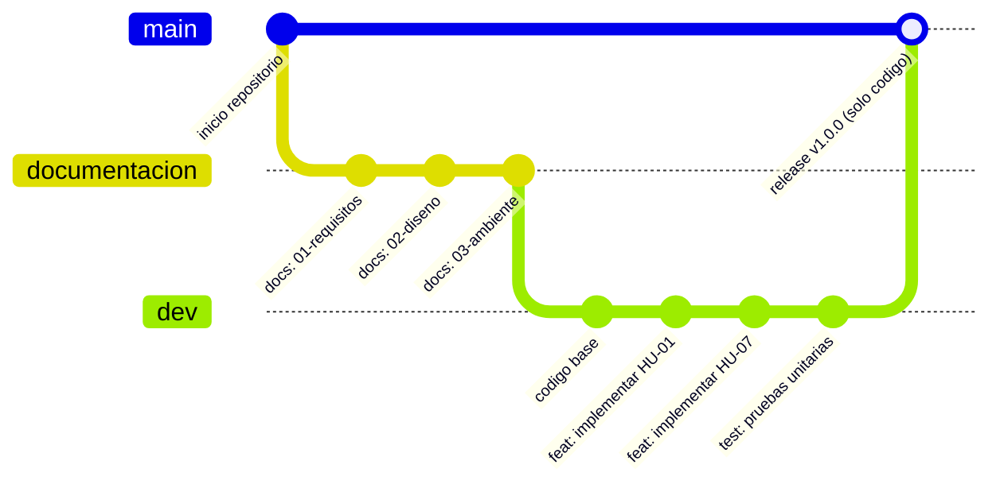

# Estrategia de ramificación y flujo de trabajo en Git

**Release:** 1.0  
**Versión del documento:** 1.0  

## 1. Estructura de las tres ramas

El repositorio utiliza únicamente tres ramas permanentes, separando con total claridad el código fuente de los documentos:



| Rama | Contenido | Propósito y flujo de trabajo |
|---|---|---|
| **`documentacion`** | Carpetas `01` a `08` y el `README.md`. | **Rama exclusiva de documentación.** Aquí se redactan, corrigen y mantienen los requisitos, casos de uso, diseño y manuales. Es permanente e independiente: **nunca se fusiona con `main` ni con `dev`**. |
| **`dev`** | Código fuente (`src/`, `db/`, `pom.xml`, `Dockerfile`, etc.). | **Rama de desarrollo de código.** Aquí se programa directamente todo el código Java, vistas JSP y scripts de base de datos. No se usan ramas temporales (`feature/*`); el desarrollo se realiza y versiona directamente en `dev`. |
| **`main`** | Código fuente estable. | **Rama de publicación y entrega.** Recibe únicamente el código probado proveniente de `dev` al momento de liberar la versión final del sistema. **No contiene carpetas de documentación**. |

## 2. Flujo de trabajo por rama

### 2.1 En la rama `documentacion`
Todo el trabajo de documentación se realiza directamente en esta rama:

1. Ubicarse en la rama:
   ```bash
   git switch documentacion
   ```
2. Crear o editar los archivos Markdown en las carpetas correspondientes (`01-requisitos`, `02-diseño`, etc.).
3. Confirmar los cambios con un commit de tipo `docs`:
   ```bash
   git add 02-diseño/
   git commit -m "docs: actualizar arquitectura y mapa navegacional"
   ```
4. Subir los cambios al repositorio remoto:
   ```bash
   git push origin documentacion
   ```

### 2.2 En la rama `dev`
Todo el desarrollo de la aplicación se realiza directamente sobre `dev`:

1. Cambiar a la rama de desarrollo:
   ```bash
   git switch dev
   git pull origin dev
   ```
2. Programar las funcionalidades en Java/JSP y crear las pruebas unitarias.
3. Verificar localmente que todo compile y pase las pruebas:
   ```bash
   mvn test
   ```
4. Confirmar los cambios identificando la historia de usuario:
   ```bash
   git add src/
   git commit -m "feat: implementar registro de clientes (HU-01)"
   ```
5. Subir directamente a `dev`:
   ```bash
   git push origin dev
   ```

### 2.3 En la rama `main`
Cuando el sistema esté terminado y probado en `dev`:

1. Se fusiona `dev` hacia `main`:
   ```bash
   git switch main
   git merge dev
   git push origin main
   ```
2. `main` queda con el código estable listo para la demostración y evaluación, sin mezclar carpetas de documentación.

## 3. Convención de mensajes de commit

Formato: `tipo: descripción en infinitivo o imperativo`.

| Rama donde se usa | Tipo | Uso | Ejemplo |
|---|---|---|---|
| **`documentacion`** | `docs` | Documentos de requisitos, diseño, manuales | `docs: alinear casos de uso con HU` |
| **`dev`** | `feat` | Nueva funcionalidad en código | `feat: generar codigo de retiro LL-DD (HU-07)` |
| **`dev`** | `fix` | Corrección de un defecto en código | `fix: validar rango de cantidades entre 1 y 10 (HU-05)` |
| **`dev`** | `test` | Pruebas unitarias de modelo o servicio | `test: pruebas de logica de pedidos` |
| **`dev`** | `chore` | Configuración de Docker, Maven o BD | `chore: configurar variables de postgresql` |
