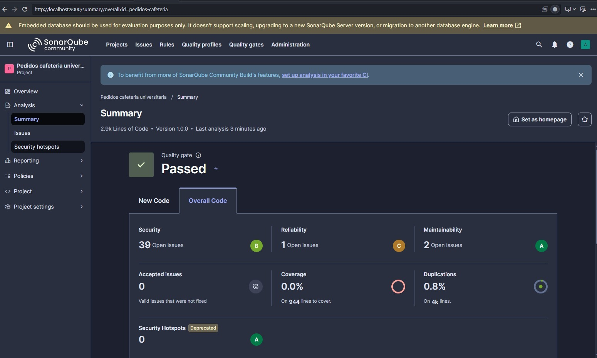
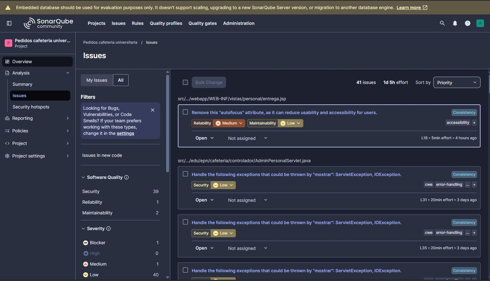

# Reporte de análisis estático del código

**Release:** 1.0  
**Versión del documento:** 1.0  
**Fecha del análisis:** 25/11/2026

## 1. Herramienta y configuración

| Elemento | Valor |
|---|---|
| Herramienta | SonarQube Community Build 26.11 (contenedor `sonarqube:community`) |
| Escáner | SonarScanner for Maven 5.7.0.6970 (`sonar-maven-plugin` del `pom.xml`) |
| Perfil de reglas | Sonar way (Java, JSP/HTML, CSS) |
| Puerta de calidad | Sonar way |
| Código analizado | Rama `dev` con todas las historias integradas (58 archivos, 2.892 líneas de código) |

### Cómo repetir el análisis

```bash
docker run -d --name sonarqube -p 9000:9000 sonarqube:community
```

Entrar a <http://localhost:9000> con `admin` / `admin`, cambiar la clave, crear un token en *My Account › Security* y luego, desde la raíz del proyecto:

```bash
mvn verify sonar:sonar -Dsonar.host.url=http://localhost:9000 -Dsonar.token=<token>
```

## 2. Primer análisis

El primer análisis se hizo con todo el código de `feature/estructura-base`, `feature/autenticacion`, `feature/gestion-menu`, `feature/pedido-cliente` y `feature/atencion-pedidos` ya integrado en `dev`.

| Métrica | Resultado |
|---|---|
| Puerta de calidad | Aprobada |
| Bugs (fiabilidad) | 0 · calificación A |
| Vulnerabilidades (seguridad) | 39 · calificación B |
| Code smells (mantenibilidad) | 2 · calificación A |
| Security hotspots | 0 |
| Duplicación | 0,8 % |
| Deuda técnica | 15 min |

### Hallazgos

| # | Regla | Severidad | Archivo | Descripción |
|---|---|---|---|---|
| 1 | java:S1845 | Bloqueante | `controlador/Web.java` | El método `usuario()` se llama igual que la constante `USUARIO` salvo por las mayúsculas; puede confundirse al leer el código. |
| 2 | Web:S9379 | Mayor | `vistas/personal/entrega.jsp` | El atributo `autofocus` del campo de código puede dificultar el uso con lectores de pantalla. |
| 3 a 41 | java:S1989 | Menor | Servlets (`doGet`/`doPost`) | Los métodos de los servlets declaran `ServletException` e `IOException` que lanzan `Web.mostrar` y `Web.redirigir`. Sonar los marca porque una excepción sin manejar podría mostrar el detalle del error al usuario. |

## 3. Análisis de los hallazgos y solución

**Hallazgo 1 (S1845).** Es un problema real de legibilidad: `Web.usuario(req)` y `Web.USUARIO` hacen cosas distintas (uno devuelve el usuario y el otro es el nombre del atributo de sesión). Se renombró el método a `usuarioEnSesion` en `Web.java` y en los tres lugares que lo usaban (`AuthFilter`, `ConfirmarServlet`, `MisPedidosServlet`). Corregido en la rama `fix/hallazgos-sonarqube`.

**Hallazgo 2 (S9379).** El foco automático en el campo del código ayudaba al personal en el mostrador, pero al cargar la página salta el contenido para quien usa lector de pantalla. Se quitó `autofocus`; el campo sigue siendo el primero del formulario y se llega a él con una sola tecla Tab. Corregido en la misma rama.

**Hallazgos 3 a 41 (S1989).** Revisamos los 39 casos. Las excepciones que se propagan son errores de infraestructura (no se encontró la JSP o se cortó la conexión con el navegador), no errores del usuario. Los errores de negocio ya se manejan dentro de cada servlet con `ReglaNegocioException` y se muestran como mensaje. Además `web.xml` define una página de error para los códigos 404 y 500 (`WEB-INF/vistas/error.jsp`) que muestra un mensaje genérico, así que el detalle técnico nunca llega al navegador; Tomcat lo deja en su registro. Por eso decidimos **aceptar** estos hallazgos sin cambiar el código: envolver cada `forward` en un `try/catch` solo repetiría lo que ya hace la página de error.

## 4. Segundo análisis (después de las correcciones)

| Métrica | Primer análisis | Segundo análisis |
|---|---|---|
| Puerta de calidad | Aprobada | Aprobada |
| Bugs | 0 (A) | 0 (A) |
| Vulnerabilidades | 39 (B) | 39 (B), aceptadas según la sección 3 |
| Code smells | 2 (A) | **0 (A)** |
| Deuda técnica | 15 min | **0 min** |
| Duplicación | 0,8 % | 0,8 % |
| Complejidad ciclomática total | — | 446 |
| Densidad de comentarios | — | 10,9 % |





## 5. Observaciones

- La cobertura aparece en 0 % porque no configuramos JaCoCo; las pruebas sí se ejecutan con `mvn test` (ver [06-pruebas](../06-pruebas/pruebas.md)). Queda como mejora para el siguiente release.
- No aparecieron security hotspots: las consultas usan `PreparedStatement`, las contraseñas se guardan con BCrypt y los datos que escribe el usuario se muestran con `<c:out>`, que escapa el HTML.
